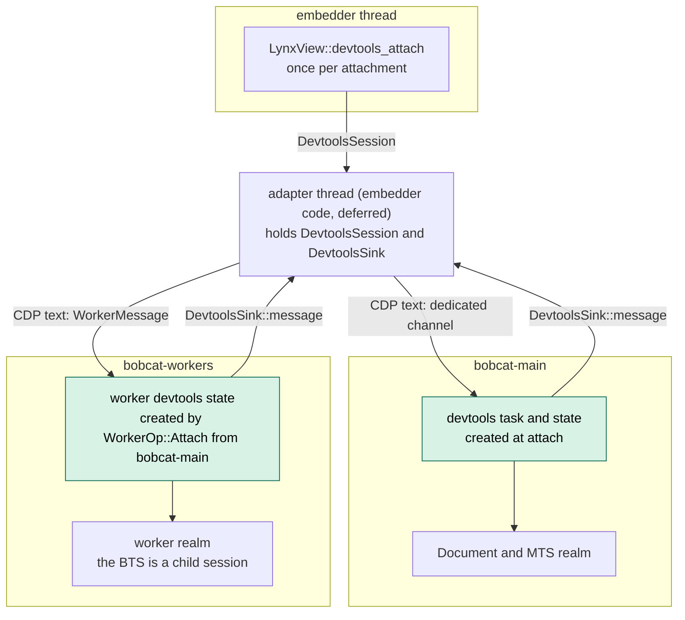

# Devtools: design

Design written 2026-11-26. The first version is implemented behind the
`devtools` cargo features of `bobcat-core`, `terminus` and
`quickjs-rust-bridge` (`bobcat-core`'s feature turns on the other two). §2 is
what the user ruled; the other sections are the design as built, and §10 lists
what is still open or not verified. The detailed description of the code is
`crates/bobcat-core/docs/devtools.md`. A path with no crate prefix is under
`crates/bobcat-core/src/`.

## 1. Goal and first version

One Chrome DevTools Protocol (CDP) backend in `bobcat-core`: CDP JSON text in,
CDP JSON text out, for one attached view. Transports are adapters in an
embedder and are deferred (§8). The eventual consumers are two frontends: the
stock Chrome DevTools frontend (CDP over WebSocket) and the Lynx DevTool
desktop application (CDP inside the DebugRouter envelope).

| First version | |
| --- | --- |
| In | Elements: tree, attributes, computed and matched styles, box model. Node highlight and inspect mode. Console. `Runtime.evaluate` and object inspection. The BTS and other workers as child sessions. |
| Out, ruled | Screenshot, screencast, input injection: the only features that need the `Painter`. |
| Out, proposed | Breakpoints (the pinned QuickJS has no debugger API). Interrupting running script (§10). `awaitPromise` in `Runtime.evaluate` and `Runtime.callFunctionOn`. Side-effect-free evaluation (`throwOnSideEffect`). Editing the document or styles from the frontend. |
| Not discussed | The Network, Performance, Memory and Application panels. |

## 2. Rulings (user, 2026-11-26)

1. **One frontend is attached to a view at a time.** A second attach is
   refused. Whether a new frontend replaces the old one is adapter policy:
   detach, then attach.
2. **A message without `sessionId` addresses the view's page and its MTS
   realm.** This is fixed, not chosen at attach. Lynx's own devtool does the
   opposite: `LynxDevToolMediator::DispatchJSMessage`
   (`lynx/devtool/lynx_devtool/agent/lynx_devtool_mediator.cc`) sends a message
   without `sessionId` to the BTS debugger and one with it to the MTS
   debugger. A Lynx DevTool adapter therefore either accepts a console that
   evaluates in the MTS realm by default or rewrites `sessionId`.
3. **JS values are serialized to CDP JSON by Rust through the QuickJS C API**,
   not by script running in the debugged realm.
4. **Two switches**: a cargo feature that keeps devtools code out of a build,
   and a runtime switch inside a build that has it.
5. **No performance impact when devtools is off** (§6).
6. **The architecture follows browser implementations**, not the
   implementation details of Lynx native's devtool (§3).
7. **The first version has no screenshot, screencast or input injection.**
8. **Adapters are deferred.**

## 3. What browsers do

Read at `chromium/chromium` 09aa0e0f, `v8/v8` 16df9819 and
`mozilla-firefox/firefox` d6a56d53.

The backend runs on the thread that owns the data. No protocol code runs on
the compositor thread, and neither browser has a thread whose job is to run
devtools logic.

| Mechanism | Chromium | Gecko |
| --- | --- | --- |
| Embedder-facing interface | `DevToolsAgentHost::AttachClient` / `DispatchProtocolMessage` / `DetachClient`, answers through `DevToolsAgentHostClient` (`content/public/browser/`) | a transport's `send` and `hooks.onPacket` (`devtools/shared/transport/transport.js`) |
| DOM, CSS, page script | Blink agents on the renderer main thread (`third_party/blink/renderer/core/inspector/devtools_agent.h`, class comment) | actors on the main thread of the target's process (`devtools/server/devtools-server.js`) |
| Worker script | agents on the worker thread; the worker's receiver is bound on the IO thread, not on the renderer main thread (`devtools_agent.h`, `BindReceiverForWorker`) | a debugger script in the worker, strings to and from the main thread (`dom/workers/nsIWorkerDebugger.idl`) |
| Routing layer parses | the top-level `id`, `method`, `sessionId`, `params` only (`third_party/inspector_protocol/crdtp/dispatch.h`, `Dispatchable`) | the actor-name prefix (`devtools/server/devtools-server-connection.js`, `onPacket`) |
| Sub-targets | child sessions keyed by `sessionId` (`content/browser/devtools/devtools_session.cc`) | forwarding by actor prefix |
| Input, screenshot | browser-process UI thread (`content/browser/devtools/protocol/input_handler.cc`, `page_handler.cc`) | screenshot in the parent process (`devtools/server/actors/utils/capture-screenshot.js`) |
| Socket IO | its own thread, posting to the UI thread (`content/browser/devtools/devtools_http_handler.cc`) | callbacks on the thread that made the transport |
| Compositor | receives flags only: a main-thread agent writes `cc::LayerTreeDebugState` and the HUD layer draws | not searched |
| Script running or paused | a second pipe on the renderer IO thread for 13 methods that run no page script, plus a nested loop while paused (`devtools_session.cc`, `ShouldSendOnIO`) | a nested event loop entered from the pause handler (`devtools/server/actors/thread.js`) |
| Node identity | per-session id table filled as nodes are sent; changes reported only under parents whose children were requested (`inspector_dom_agent.cc`, `Bind`, `DidInsertDOMNode`) | one `NodeActor` per node the client was told about (`devtools/server/actors/inspector/walker.js`) |
| JS values | V8 inspector, C++ inside the engine, behind `V8InspectorSession::dispatchProtocolMessage` (`include/v8-inspector.h`) | the engine's `Debugger` API |
| Highlight | drawn in the renderer by an overlay page into a frame overlay layer (`inspector_overlay_agent.cc`) | drawn in the content document's anonymous content (`devtools/server/actors/highlighters/utils/markup.js`) |

Gecko's tree has no CDP implementation: `remote/` holds Marionette and
WebDriver BiDi only. Gecko is a structural reference, not a protocol one.

The mapping onto this engine: the renderer main thread is `bobcat-main`, a
worker thread is `bobcat-workers`, and the browser-process UI thread is the
embedder thread. Chromium routes on its UI thread because its input,
screenshot and target handlers live there. With ruling 7 this engine has no
embedder-side handler, so nothing is routed through the embedder thread.

## 4. Architecture



No thread is added. The `Painter` takes no part. `LynxView::pump`,
`ViewNotice` and `EngineEvent` do not change.

### 4.1 Public surface

```rust
// All of it behind the `devtools` feature of bobcat-core.
pub struct ViewSources {
    // ...
    /// The runtime switch, `false` in `ViewSources::new`. A view created
    /// without it refuses to attach.
    pub devtools: bool,
}

impl<F: ResourceFetcher + 'static> LynxView<F> {
    /// Attaches one frontend. Called on the embedder thread, also before the
    /// view is ready; the session it returns may be moved to another thread.
    pub fn devtools_attach(
        &self,
        sink: Arc<dyn DevtoolsSink>,
    ) -> Result<DevtoolsSession, EngineError>; // DevtoolsDisabled, DevtoolsAttached, NotReady
}

/// Send. Dropping it detaches.
pub struct DevtoolsSession { /* outlet, worker routes, channel to bobcat-main */ }

impl DevtoolsSession {
    /// One CDP message as JSON text.
    pub fn send(&self, message: String);
}

/// Called on the thread of the realm that produced the message. It must not
/// block, must not call back into the engine, and must not drop the session.
pub trait DevtoolsSink: Send + Sync + 'static {
    /// One CDP response or event as JSON text.
    fn message(&self, message: String);
    /// The view ended or failed while attached.
    fn closed(&self);
}
```

`DevtoolsSession` and `DevtoolsSink` are exported from the crate root. A
session is one view. The embedder creates its views and lists them; the core
keeps no table of targets.

### 4.2 Messages in

`DevtoolsSession::send` runs on the caller's thread. It reads the top-level
`sessionId` of the message and sends the text on:

- **No `sessionId`**: into an unbounded channel that exists only for this
  attachment. Its receiver reaches `bobcat-main` once, in the attach command:
  one boxed `ToMain` variant, `ToMain::Devtools(Box<Attach>)`, sent through the
  seat's counting `CommandSender`. A task of the view (`serve_devtools`,
  `main/page.rs`, started with `owner::spawn`) reads the channel and queues
  one job per message (`owner::queue`, `JobKind::Devtools`), never awaiting it.
- **A worker's `sessionId`**: as a `WorkerMessage` to that worker, through a
  table of weak worker senders the session shares with the main-thread state
  (`WorkerRoutes`). Each worker operation is one boxed `WorkerMessage` variant,
  `WorkerMessage::Devtools(Box<WorkerDevtools>)`, whose operation is `Attach`,
  `Message` or `Detach`. The page realm already keeps one sender per live
  worker (`main/workers.rs`, `WorkerOwner::live`); the main-thread state fills
  the table from it when the frontend sends `Target.setAutoAttach` with
  `flatten: true` (§4.4) and keeps it current while auto-attach is on. The
  table is behind a lock that is taken once per message that carries a
  `sessionId`.

A message for the page realm is one job. What that job's script leaves behind
(the checkpoint after it) is reported under the devtools scene of the realm's
error table, `Scene::Devtools` (`realm/policy.rs`): `ScriptRunError` on the
page and `WorkerPayload::Errored` on a worker, with the context
`in a devtools request`, ending nothing. A worker holds its devtools messages,
in order, until its root module has finished, as it holds posted messages, and
then queues one job per message in the same way.

A `ToMain` variant per message was rejected. The command consumer waits for
the job it queued, so it reads nothing while a job is parked
(`crates/bobcat-core/docs/public-surface.md`, the `JsThread` paragraph), and
every `ToMain` either counts toward the frame-post fence or needs an entry in
the list `Page::apply` excludes from it.

### 4.3 Messages out

The state that answers calls `DevtoolsSink::message` on its own thread:
`bobcat-main` for the page and the MTS realm, `bobcat-workers` for a worker. A
worker adds the top-level `sessionId` to what it sends. Order is kept per
realm; CDP pairs a response with its request by `id`. `DevtoolsSink::message`
is called with the attachment's outlet locked, and dropping the session takes
the sink out of the outlet under the same lock, so no `message` call starts
after the session was dropped.

### 4.4 Targets

- The default target is the view: its document and its MTS realm.
- Each worker of the view is a child session, announced with
  `Target.attachedToTarget` once the frontend sends `Target.setAutoAttach`
  with `flatten: true` (any other `flatten` is refused); workers started later
  are announced at start, and ended ones with `Target.detachedFromTarget`. The
  BTS is the worker created from `bobcat:bts` (`esm.rs`,
  `BTS_MODULE_SPECIFIER`). The `sessionId` and `targetId` are both
  `worker-<key>`. Messages carry the child's `sessionId` at the top level
  (CDP's flat sessions).

### 4.5 Attach, detach, lifetime

- `devtools_attach` refuses a view created without the runtime switch
  (`DevtoolsDisabled`), a view that already has a live session
  (`DevtoolsAttached`), and a view that has ended (`NotReady`).
- It may be called before the view is ready: the attach command is a job
  queued behind the one that opens the realm.
- Dropping the session closes the channel. The task on `bobcat-main` queues
  one last job, which drops the page state; each worker the session routed to
  is told to drop its own (`WorkerOp::Detach`). No answer of an earlier
  attachment can reach a later one, because each attachment has its own
  outlet, and the outlet of a dropped session has no sink.
- `DevtoolsSink::closed` is called once, on an engine thread, when the view
  ends or fails while the session is alive, and never after the session was
  dropped.
- `LynxView::reload` calls the MTS `Reload` export in the same realm
  (`main/runtime/lib.rs`, `apply_page_update`); it rebuilds neither the realm
  nor the document, so it does not affect an attachment.
- A devtools "reload" means fetching the bundle again, which is the embedder
  replacing the view. The core does not execute `Page.reload`.
- `Painter::attach` reads `Rc::weak_count` of the view's seat to tell whether a
  view has a painter (`paint/lib.rs`). Devtools code does not downgrade the
  seat.

## 5. Domains

### 5.1 JSON ownership

- Rust parses the envelope only: `id`, `method`, `params`, `sessionId`.
  `DevtoolsSession::send` reads `sessionId` alone; the job that answers parses
  the rest.
- Rust writes the JSON of what Rust owns: tree, attributes, styles, boxes,
  with `serde_json`.
- JS values are read by Rust through `quickjs-rust-bridge` (§5.4). AGENTS.md
  "JavaScript data ownership" is about host payloads handed to script; this is
  the opposite direction and Rust needs the fields.

### 5.2 DOM

- CDP `nodeId` and `backendNodeId` are `NodeId::to_bits()`
  (`crates/terminus/src/tree/arena.rs`): a 32-bit key and a 21-bit generation,
  exact as a JSON number, the value script already receives as `unique_id`. There
  is no id table, and a stale id fails the generation check.
- The state keeps every node the frontend was told about, with what it was
  sent: a text node's data; an element's attributes and shadow root, and either
  the child ids sent or, when its children were not sent, their count. Changes
  are reported under parents whose children were sent; for the others only the
  count is reported (`DOM.childNodeCountUpdated`), as both browsers do.
- Changes are found in one function, `dom::document_changed`, called after the
  commit of `DocumentSlot::commit_flush` and of `commit_if_dirty`, and at the
  start of every page message job, only while `DOM` is enabled and a document
  was sent. It compares the known nodes with the document. A moved child is
  reported as removed and then inserted. No probe is added to the tree mutation
  functions (`crates/terminus/src/tree/document.rs`), to the Element PAPI or to
  the realm epilogue. While attached, the cost per call is one map lookup per
  known node and an attribute comparison per known element.

### 5.3 CSS

- Computed values come from the existing `Document::computed_style_entries`,
  the box from `Document::bounding_client_rect` and `Document::rounded_layout`,
  read on request from the last layout; nothing flushes.
- Matched rules come from `Document::matched_styles`
  (`crates/terminus/src/style/matched.rs`), built per call by walking every
  rule of the document's sheets and of the shadow roots that can apply to the
  element, and mapping the element's rule-node chain back to its rules by
  pointer. Nothing is cached. Rules carry no style sheet id and no source
  range, so none is editable.

### 5.4 Runtime and Console

- `Runtime.evaluate` and `Runtime.callFunctionOn` run page script, which is
  their purpose. Results and console arguments are read without running
  script.
- Each realm keeps a table from `objectId` to a held value, released by
  `Runtime.releaseObject`, `Runtime.releaseObjectGroup`, `Runtime.disable` and
  detach.
- What the bridge provides with its `devtools` feature
  (`crates/quickjs-rust-bridge/src/implementation/devtools.rs`, over
  `PupilTong/quickjs` 0f282725):

  | Need | As built |
  | --- | --- |
  | The kind of an object | `Context::object_class`: `Proxy`, `Array`, `Error`, `Promise` with its state and result, then by class id a typed array with its length, `Map`, `Set`, `Date`, `RegExp`, then `Function` or `Object`. `quickjs.h` exports no class ids, so the shim reads them once per runtime, at the first reflection call, from objects made in a temporary realm no page code ran in. |
  | Own properties and descriptors, with getter and setter as values | `Context::own_properties` with `OwnKeys::All`, or `OwnKeys::NonIndexed`, which leaves the array-index keys out; `Context::own_property` for one key |
  | Prototype | `Context::prototype` |
  | A value as text | `Context::describe`, `JS_PrintValue` |
  | Recognising a Proxy | by class id, before anything reads it; the three object reads answer `Reflected::Proxy`, so no trap runs |
  | A Proxy's target and handler | not available; needs a function in the fork |
  | Map and Set entries as structured data | not available (only as `describe` text); needs a function in the fork |
  | A host function that receives `Value`s | `Context::function_with_values` |
  | Breakpoints | none |

- Console: the built-in `console` (`packages/bobcat-element/src/diagnostics.ts`)
  joins its arguments into one string and calls the host function
  `logScriptMessage`, which becomes `EngineEvent::ConsoleMessage`
  (`realm/mod.rs`, `install_diagnostics`).
  - At the first `Runtime.enable` of a realm, Rust replaces the five methods
    `log`, `info`, `debug`, `warn` and `error` of the `console` object
    `bobcat:diagnostics` exports. Each replacement calls one host function with
    the raw arguments, which reports `Runtime.consoleAPICalled` and then calls
    the original method, so `EngineEvent::ConsoleMessage` is unchanged.
  - The replacements stay for the realm's life: restoring them could overwrite
    a replacement the page installed meanwhile (§9). After `Runtime.disable` or
    detach they only call the original.
  - A reference to a console method that script saved before the install
    reaches `logScriptMessage` and is reported with one string argument.
- Errors the realm reports (`realm/policy.rs`, `report`) are sent as
  `Runtime.exceptionThrown` while the realm's `Runtime` domain is enabled.

### 5.5 Highlight and inspect mode

- Highlight: `Document::set_node_highlight` (`crates/terminus/src/paint/highlight.rs`)
  stores one node and four colours. The paint walk (`walk_within`,
  `crates/terminus/src/paint/walker.rs`) records it after every page item, in
  the node's own compose space, as fills of the content box and the padding,
  border and margin areas. It needs no node-to-rectangle query on the
  committed frame and no `Painter` path, and a highlight inside a scroll
  container moves with composition. The highlight is in no paint item, so hit
  testing does not see it.
- Inspect mode: an input event already reaches `bobcat-main` with the node the
  painter's hit test found (`ToMain::DispatchEvent`). While the mode is on,
  the main-thread state takes every input event that reaches the main thread
  instead of dispatching it. The mode routes `pointerdown`, `pointermove` and
  `pointerup`: they are added to the published listener set while the mode is
  on. `pointerdown` and `pointermove` move the highlight to the target, and
  `pointerup` requests the node (`Overlay.inspectNodeRequested`).
- `DOM.getNodeForLocation`: `bobcat-main` hit-tests the frame it retained
  (`Document::elements_from_point`; `docs/terminus-architecture.md`, "Visual
  order, paint and the committed frame").

## 6. Cost when off

**Feature off.** No devtools item, field, variant or branch is compiled, and a
wasm package does not grow by the devtools code. Two changes reach a build
without the feature: the `const` size assertions on `ToMain` and
`WorkerMessage`, which are checked at compile time only, and the bridge's
host-function dispatch, which now reads the arguments inside each arm of its
`match` instead of before it.

**Feature on, view created without the switch or not attached.** No
instruction is added on a per-node or per-property path. Per commit, per paint
walk and per input event it adds the `Option` checks below. What remains:

| Site | Cost |
| --- | --- |
| `ViewSources`, `LynxView` | one field each |
| `ToMain`, `WorkerMessage` | one boxed variant each, never sent; a compile-time assertion beside each keeps `ToMain` at most 96 bytes and `WorkerMessage` at most 56 on 64-bit targets |
| Tree mutation, Element PAPI, realm epilogue, `LynxView::pump` | nothing |
| Realm creation | one console tap allocated (`Rc<ConsoleTap>`); no function registered |
| `logScriptMessage`, `reportScriptError` | one flag read per call |
| An error the realm reports (`policy::report`) | one read of the owner's tap and one flag read |
| Commit | one `Option` check after it (the DOM hook) |
| Paint walk | one `Option` check (the highlight) |
| Input event delivered to the main thread | one `Option` check |
| Route predicate (`DocumentSlot::routes_given`) | one boolean, evaluated when routes change |
| Worker start and end | one `RefCell` borrow and `Option` check each |
| The bridge's host-function dispatch | one `match`, as before, with one more arm |
| Binary size | the devtools code |

**Verification.** CodSpeed instruction counts on the existing benches: with
the feature off they must not change; with it on and nothing attached the
difference is the rows above. This comparison has not been run.

## 7. Where the code goes

| Piece | Crate | Files |
| --- | --- | --- |
| Session, sink, outlet, worker routes, envelope and replies | `crates/bobcat-core`, behind its `devtools` feature | `devtools/mod.rs`, `devtools/protocol.rs` |
| Page session, routing and hooks | `crates/bobcat-core` | `main/runtime/devtools.rs`; `serve_devtools` in `main/page.rs`; the hooks in `main/runtime/lib.rs`, `main/runtime/editing.rs`, `main/workers.rs`, `realm/mod.rs`, `realm/policy.rs` |
| Worker session | `crates/bobcat-core` | `devtools/worker.rs`; `deliver_devtools` in `background/thread.rs` |
| `Target`, `Runtime`, `DOM`, `CSS`, `Overlay` domains, the object table and RemoteObjects | `crates/bobcat-core` | `devtools/target.rs`, `devtools/runtime.rs`, `devtools/runtime/remote.rs`, `devtools/dom.rs`, `devtools/css.rs`, `devtools/overlay.rs` |
| Reading a JS value without running script; a host function that receives `Value`s | `crates/quickjs-rust-bridge`, behind its `devtools` feature | `src/implementation/devtools.rs`, the `QJS_BRIDGE_DEVTOOLS` block of `src/shim.c` |
| Matched rules; the highlight draw items | `crates/terminus`, behind its `devtools` feature | `src/style/matched.rs`; `src/paint/highlight.rs`, called from `src/paint/walker.rs` |
| Transports | the embedders | none yet (§8) |

## 8. Adapters (deferred)

An adapter owns a transport, obtains a `DevtoolsSession` from the embedder
thread, calls `send` for what it reads and writes what its sink receives.

- **Chrome DevTools**: HTTP `/json/version` and `/json/list`, one WebSocket per
  target (`content/browser/devtools/devtools_http_handler.cc`).
- **Lynx DevTool** (`lynx-family/debug-router` c7325cdb,
  `lynx-family/lynx-devtool` 24371178): the application polls `127.0.0.1`
  ports from 8901 for a TCP server on the debugged side
  (`debug_router/native/socket/`); frames have a 20-byte big-endian header and
  a JSON envelope `{event, data}` (`debug_router/native/protocol/`); a CDP
  message is the `message` field of a `Customized` event of type `CDP`, beside
  `session_id` and `client_id`. Its frontend is a fork of the Chrome DevTools frontend that
  connects by `postMessage` only
  (`packages/devtools-frontend-lynx/front_end/core/sdk/Connections.ts`), so it
  cannot be given a WebSocket endpoint.

## 9. Alternatives rejected

- **Routing on the embedder thread** (`LynxView::devtools_send`, answers out of
  `pump`). With no `Painter`-served method the embedder thread would only
  relay, and it is the thread that draws.
- **A global devtools thread.** It would route and nothing else, which the
  thread an adapter reads its transport on already does; on wasm it is one
  more Web Worker. A worker thread becomes worth having for CPU work such as
  encoding screencast frames, which Chromium gives to its thread pool.
- **A process-wide service object with a target table.** The embedder already
  owns its views.
- **A serializer written as built-in script in the debugged realm.** Ruling 3:
  page script can replace built-ins, and getters and Proxy traps would run.
- **Probes in the tree mutation path.** They cost every page.
- **A highlight drawn by the `Painter`.** It needs a node-to-rectangle query on
  the committed frame and a route to the embedder thread.
- **Restoring the console methods at `Runtime.disable` or detach** (rejected
  during implementation). Page script may have replaced a console method after
  the install; writing the original back would overwrite the page's
  replacement. The replacements stay instead and, with capture off, only call
  the original.

## 10. Open and not verified

Not ruled:

- The public surface of §4.1 and the runtime switch as a `ViewSources` field.
- Console messages produced before a frontend attaches, or before
  `Runtime.enable`. None is kept. V8 keeps the last 1000, up to 10 MB, and
  replays them at `Runtime.enable` (`src/inspector/v8-console-message.cc`).
- Which embedder builds turn the feature on by default.
- `ShadowRealm` child realms (`<frame>`) as further execution contexts of the
  page target. As built, a child realm shares its parent's console tap: its
  console calls and errors are reported under the parent's context, and it is
  not a separate execution context.
- Interrupting running script. While a job runs, no task of that thread runs,
  so a message for that realm waits. `Runtime.terminateExecution` would use
  the bridge's `InterruptHandle`, which is thread-safe but interrupts whatever
  task is running on the runtime; the views of a group share one runtime, so
  the request must name its target.

Not verified:

- No embedder enables the feature and none has a transport, so no real
  frontend has been attached to this backend. Which CDP methods each frontend
  requires at startup, and whether it tolerates "method not found" for the
  rest, is not verified.
- How the Chrome frontend treats node ids above 2^31.
- Three behaviours were taken from recollection of Chromium and not checked
  against its source: whether `Overlay.enable` is required before the other
  `Overlay` methods (here it is not); `Overlay.setInspectMode` without a
  `highlightConfig` (here the mode turns on with every colour transparent and
  no error); and `DOM.getDocument`'s default depth, which is 1 here where
  Chromium's code uses 2.
- wasm32: `cargo check -p bobcat-core --features devtools --target wasm32-unknown-unknown` passes (2026-11-27). Nothing of the backend has run on wasm32, and `bobcat-wasm` does not enable the feature.
- The CodSpeed instruction-count comparison of §6 has not been run.
