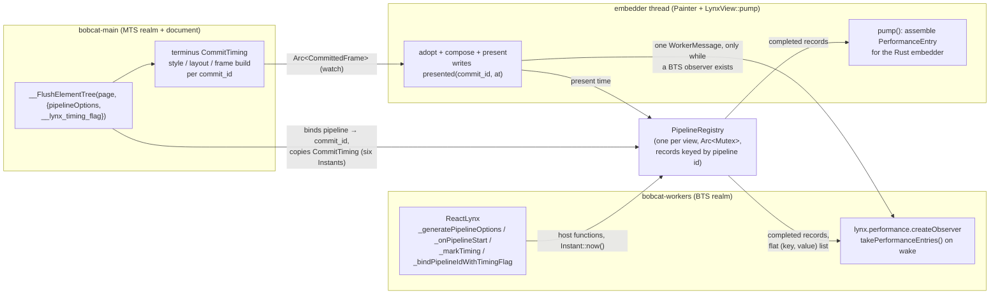

# Performance observation: design

Design proposal, 2026-10-23, revised the same day under the rulings in §11.
Goals, in the order the user stated them:

1. The BTS realm offers the Lynx-compatible API (`lynx.performance`,
   `PerformanceObserver`, the pipeline hooks ReactLynx calls).
2. `terminus` offers behavior and interfaces as close to the browser
   standards as its scope allows, with no Lynx vocabulary.
3. The Rust API (`bobcat-core`) has the capability of Lynx native's platform
   API, shaped as idiomatic Rust rather than a port of the Java/ObjC classes.
4. No runtime cost on a page that observes nothing, and no work on the main
   thread for a consumer that is not the main thread.
5. The numbers are comparable with Lynx native's: same entry names, same
   key names, same formulas, same clock semantics.

The survey of what Lynx native has (engine services, platform APIs, JS API,
tracing) is the memory note `lynx-native-perf-observation-survey`; §1 repeats
only what this design builds on.

## 1. What is being matched

Lynx native's current metrics system is one callback,
`onPerformanceEvent(PerformanceEntry)`, fed by `TimingHandlerNg`
(`lynx/core/services/timing_handler/timing_handler_ng.cc`). An entry is
`{entryType, name, ...attributes}`; the attributes are camelCase keys holding
Unix timestamps in milliseconds with microsecond precision (`1739594612307.429`),
or `PerformanceMetric {name, duration, startTimestampName, startTimestamp,
endTimestampName, endTimestamp}` records. The truth for every entry's shape is
`lynx/tools/performance/performance_observer/definition_yaml_files/*.yml`.

The entries that are not deprecated:

| entryType.name | Produced by | Built here |
| --- | --- | --- |
| `pipeline.loadBundle` (`LoadBundleEntry`) | the first-screen pipeline | phase 1 |
| `pipeline.reloadBundleFromNative`, `pipeline.reloadBundleFromBts` (`ReloadBundleEntry`) | a reload | phase 1 |
| `pipeline.updateTriggeredByBts`, `.updateTriggeredByNative`, `.updateGlobalProps`, `.setNativeProps`, `.reactLynxHydrate` (`PipelineEntry`) | a flush bound to a `__lynx_timing_flag` | phase 1 |
| `resource.lazyBundle` | a lazy bundle load | phase 2 |
| `container` (W3C Container Timing, no Lynx equivalent) | a presented frame that grew a `containertiming` root's painted region | phase 2 |
| `memory.memory` | the memory monitor, when enabled | phase 2 |
| `js_blocking` | the JS blocking monitor, when enabled | phase 2 |
| `metric.fsp` | the First Stable Paint tracer, when enabled | phase 3 |

Deprecated in Lynx and **not built** (ruling Q2 covers the last three): the
standalone `init.container`, `init.lynxview`, `init.backgroundRuntime`,
`metric.fcp` and `metric.actualFmp` entries (their fields live on
`LoadBundleEntry` / `ReloadBundleEntry` / `PipelineEntry` since SDK 3.7, and
the C++ NG path emits none of them), `metric.tti` (gone since 3.3), the old
Timing API (`onTimingSetup`/`onTimingUpdate`,
`lynx.performance.addTimingListener`, snake_case keys; "no longer maintained
starting from Lynx 3.1"), and `nativeApp.markTiming(flag, key)`.

Lynx's long-task, fluency and JSB timing data are not performance entries:
they are event-reporter events (`lynxsdk_long_task_timing`, …). §7 says what
of that is built.

### 1.1 The browser standards each Lynx mechanism corresponds to

| Lynx | W3C | Relationship |
| --- | --- | --- |
| `PerformanceObserver`, `PerformanceEntry {name, entryType}` | Performance Timeline L2 | Lynx copied the shape; `observe()` takes names, not `{entryTypes}` |
| `PipelineEntry` stages (`mtsRender`, `resolve`, `layout`, `paint`) | Long Animation Frames (`renderStart`, `styleAndLayoutStart`) | the same "rendering update" phases, Lynx's with both ends and more cuts |
| `__lynx_timing_flag` → `PipelineEntry.identifier` | Element Timing (`elementtiming` attribute → `renderTime`) | both mark an element and report when the frame that includes it is presented |
| a `<frame>`'s card as the unit of timing (its own LynxView) | Container Timing (`containertiming` attribute → `container` entries per subtree root) | the standard's unit is a marked subtree, not a document or a shadow tree (§6.5) |
| `fcp`, `lynxFcp`, `totalFcp` | Paint Timing `first-paint` | Lynx's "fcp" is the first commit presented, regardless of content: the standard's `first-paint`, not its `first-contentful-paint` |
| `__lynx_timing_actual_fmp` | Largest Contentful Paint, loosely | author-declared instead of heuristic |
| `fsp` | none (closest is visual-completeness tooling) | — |
| long task (`≥ 50 ms`) | Long Tasks L1 (`longtask`, 50 ms) | same threshold |
| `js_blocking` | Long Animation Frames `blockingDuration` | queue delay rather than frame delay |
| `memory` | `measureUserAgentSpecificMemory()` | both are user-agent-specific breakdowns |
| `lynx.performance.profileStart/End/Mark/FlowId` | User Timing L3 (`mark`/`measure` with `detail`) | web-core already maps them onto User Timing |
| JS CPU profile in a trace | JS Self-Profiling API | Lynx drives it from DevTool, not from the page |

The design is layered so that `terminus` implements the W3C column and
`bobcat-core` derives the Lynx column from it (goal 2 and goal 1 at the same
time, with no second clock and no second set of marks).

## 2. The one data flow



**Nothing is assembled or serialized on the main thread** (ruling Q1). The
main thread's two writes are measurements: the binding of a flush to its
`commit_id` and a copy of six `Instant`s out of `terminus`. Every entry is
built on the thread that consumes it: the embedder's, inside `pump()`, and
the BTS worker's, inside the job its observer's wake runs. The painter,
which already runs on the embedder's thread and already holds the view's
seat, is what completes a record (it knows the present time) and what wakes
the BTS. The main-thread epilogue gains no step.

## 3. Clock and timestamps

**One monotonic clock, converted once.** Marks are `ClockInstant`
(`std::time::Instant` natively, `web_time::Instant` on Wasm — the pair
`crate::clock` already names). They are taken on whichever thread the event
happens on; `Instant` is comparable across threads of one process, which is
what makes a BTS-side `diffVdomStart` and a painter-side `paintEnd`
subtractable. A view records, at construction and beside the
`timeline_epoch` it already keeps, one `SystemTime` reading taken at the
same moment. Every entry handed out converts
`unix = epoch_unix + (instant - epoch_instant)`.

**Lynx shape at the boundary.** The Rust type is
`Timestamp(ClockInstant)` with `Timestamp::unix_millis(&self, epoch) -> f64`
(ms with three decimals, Lynx's `GetAllTimingInfoAsMillisecond`), and the
Lynx field list (§6.1) writes that `f64`. Lynx's `setExtraTiming` inputs are
Unix milliseconds from the host, so `ExtraTiming` takes `SystemTime` and is
converted into the view's instant space on the way in. Native's
`hostPlatformTiming` is Android-only; this engine reports its own painter
stages under the same field with `hostPlatformType: "vello"` (§5.2).

Why not `performance.now()`-style view-relative milliseconds: Lynx's
`totalFcp = paintEnd − openTime` subtracts a host timestamp taken before the
view existed; only an absolute clock makes that comparable.

## 4. Zero cost when nothing observes

Lynx's own rule is kept: a pipeline carries timestamps only when
`PipelineOptions::need_timestamps` is set, which `_bindPipelineIdWithTimingFlag`
or a `__lynx_timing_flag` attribute sets, plus the load and reload
pipelines, which always do. Everything else below is behind that bit.

- **`terminus`**: `Document::set_commit_timing(bool)` is one field.
  `render()` reads it once; when `false` it takes no instant and the
  `CommitTiming` slot keeps `None`. When `true` it takes six `Instant::now()`
  readings into a fixed-size `Copy` struct on the document, no allocation.
  Six readings are tens of nanoseconds natively and under a microsecond on
  the Wasm `performance.now()` path; a commit is milliseconds.
  `bobcat-core` turns the field on for a flush that binds a pipeline needing
  timestamps and off again after it, so an unflagged flush reads one `bool`.
- **The flag's attribute path**: `__SetAttribute(el, '__lynx_timing_flag', v)`
  already crosses into Rust per attribute; the name test joins the attribute
  setter's existing dispatch on the name, no new branch on the general path.
- **BTS hooks**: ReactLynx calls `_generatePipelineOptions` once per update
  and `_markTiming` only when `needTimestamps` (its own guard,
  `core/performance.js` `markTiming`). `_generatePipelineOptions` answers a
  fresh id from an `AtomicU64` and nothing else; the registry allocates a
  record only on `_onPipelineStart` of a pipeline that will carry timestamps.
  For an unflagged update that is one atomic increment and one host call
  returning a small object.
- **Painter**: `Painter::set_presentation_timing(bool)` (`terminus`, on by
  default) is the switch for every presentation record. `bobcat-core`'s
  painter facade sets it before each draw from the registry's
  `wants_presentation_timing()` — a bound record waits for a present
  (`oldest_waiting_commit`), the document detects content, or the view's
  first paint is not recorded yet — two relaxed atomic loads, no lock. Off,
  a draw reads no clock and records nothing, and the facade tells the
  registry only the commit id it drew (one `fetch_max` and one load), so a
  record a flush bound to that commit meanwhile completes at once. On,
  after a present it compares the adopted `commit_id` with the registry's
  `oldest_waiting_commit` (one relaxed atomic load); only when a record
  waits does it lock, complete the record and, if a BTS observer exists
  (one `AtomicBool`), send one `WorkerMessage`. No new channel, no new
  wakeup on a page that flagged nothing; a view nobody observes times its
  presents only until its first paint is recorded and while its load
  waits for its present.
- **Content detection**: Paint Timing's contentful test runs in the paint
  walk only behind `Document::set_content_detection(bool)` (`terminus`, off
  by default). `bobcat-core`'s flush sets it before each commit from the
  registry's `wants_content_detection()` — the Rust embedder observes
  `EntryTypes::PAINT` or a BTS observer asked for `paint`, and
  `first-contentful-paint` is not recorded yet — one relaxed load and one
  `bool` compare per commit, a document write only on a change. Off, the
  walk tests one `bool` per item and per scope and nothing else.
- **Consumers**: `pump()` reads one generation counter; the BTS worker runs
  one job per wake, which drains every completed record its realm opened at
  once.
- **Container Timing**: one node bit per painted item on a page with no
  `containertiming` attribute; the region union and the ancestor walk exist
  only under a marked root.
- **Monitors** (§7) are off unless the Rust embedder turns them on, as
  Lynx's `enable_long_task_timing`, `enable_memory_monitor` and
  `enable_js_blocking_monitor` are.
- **Tracing** (§8) is a cargo feature, absent from a normal build.

The CodSpeed bench `crates/bobcat-core/benches/script_boundary.rs` gains two
cases: an update flush with no flag (must not move) and one with a flag
(measures the whole observed path). The unflagged case is the gate for goal 4.

## 5. `terminus`: the standard-shaped primitive

`terminus` knows nothing of pipelines, flags or Lynx names. It offers, on the
link (`docs/terminus-link-api.md` rows to add):

### 5.1 `CommitTiming`

```rust
pub struct CommitTiming {
    pub commit_id: u64,
    pub style_start: Instant, pub style_end: Instant,
    pub layout_start: Instant, pub layout_end: Instant,
    pub frame_build_start: Instant, pub frame_build_end: Instant,
}
impl<T> Document<T> {
    pub fn set_commit_timing(&mut self, enabled: bool);
    /// The timing of the last `render()` that built a frame, if timing was on.
    pub fn last_commit_timing(&self) -> Option<CommitTiming>;
}
```

`style_*` brackets `flush_styles_with_damage_sink` across the container
passes (`layout_pass` runs it per pass; the first pass's start and the last
pass's end are reported, matching Lynx's `resolveStart/End`, which bracket
the whole style resolution), `layout_*` brackets `run_layout_once` the same
way, `frame_build_*` brackets `build_frame_with_relevance` through
`painter.paint` (paint-order build and scene encode). The names are the
Long Animation Frames vocabulary (`styleAndLayout`, split because this
engine can) rather than Lynx's.

### 5.2 Presentation time and paint timing on the painter

`terminus::link::painter::Painter` reports, after `finish_draw` (window) or
`draw_offscreen` returns:

```rust
pub struct PresentedFrame { pub commit_id: u64, pub compose_start: Instant, pub compose_end: Instant, pub presented: Instant }
impl Painter {
    /// On by default; off, a draw reads no clock and records nothing (§4).
    pub fn set_presentation_timing(&mut self, enabled: bool);
    pub fn last_presented(&self) -> Option<PresentedFrame>;
    /// Paint Timing's two marks, as the painter saw them: the first frame it presented, and the first one that put ink on the viewport.
    pub fn first_paint(&self) -> Option<PresentedFrame>;
    pub fn first_contentful_paint(&self) -> Option<PresentedFrame>;
}
```

`presented` is the instant the present call returned (ruling Q5): after the
draw is submitted, not after the display shows it. Lynx marks `paintEnd` on
Android's draw callback and iOS's transaction commit, neither of which waits
for the display either, so the two numbers have the same meaning.
`compose_*` brackets adopt-and-compose through GPU encode; `bobcat-core`
places it under Lynx's `hostPlatformTiming`.

`first_paint` and `first_contentful_paint` carry the standard's names and
meanings (ruling Q6): the first presented frame, and the first presented
frame whose paint order holds contentful ink as Paint Timing defines it: a
non-empty text run at non-zero opacity, an image whose pixels are resolved
(an `<image>`, a background image, a vector image), an SVG with rendered
content — not a background color or a border, which count for
`first_paint` only. The test is `CommittedFrame::paints_content`, decided
by the paint walk as it encodes each item, until the first item answers
it — the glyph scan of a text run, the image and vector draw count of an
item, the `opacity: 0` scope depth — and only while the document's content
detection is on (`Document::set_content_detection`, ruling Q7); a frame
built with it off answers `false` and its walk tested nothing, so
`first_contentful_paint` is fixed only from a frame built while detection
was on.
**Comparability of the two marks (recorded 2026-10-25).** Lynx native's
`fcp`/`lynxFcp`/`totalFcp` inspect nothing that was drawn: `paintEnd` is
marked at the end of the first screen's draw pass whenever the pipeline
carries timestamps (`UIBody.dispatchDraw` → `markPaintEndTimingIfNeeded`
on Android; the transaction commit on iOS), so a first frame of one colored
`<view>` has an `fcp`. That is Paint Timing's `first-paint`, and
`first_paint` is the one mark comparable with native. `first_contentful_paint`
follows the specification's own contentful algorithm (Paint Timing
Editor's Draft §2: a text node with at least one non-white-space character
at used opacity above zero, an available image, canvas, video, SVG with
rendered content, a contentful background or border image; not a background
colour or a border) rather than any one browser's behavior. It has no Lynx
counterpart — Lynx's "meaningful content" classification
(`ILynxUIMeaningfulContent`: a `<text>` with a renderer, an `<image>` with
its bitmap, no white-space or opacity test) feeds `metric.fsp`, not `fcp` —
and browsers' measured FCP values are approximations of the same definition
under different painting strategies (WebKit gates its first paint on
heuristics, Blink does not), so a `first_contentful_paint` here is comparable
with a browser's only as the same definition, never as an exact number.
Lynx's `fcp` is `first_paint`; the renaming is `bobcat-core`'s (§6.3), and
`terminus` never spells `fcp`.

### 5.3 Container Timing: timing for one subtree

The standard's answer to "when did this part of the tree paint" is WICG
Container Timing (`https://wicg.github.io/container-timing/`; Chrome origin
trial 148–153, Firefox 156 behind a flag): a `containertiming` attribute
marks a subtree root, every paint inside the subtree is attributed to its
nearest marked ancestor, and a `container` entry
`{identifier, rootElement, firstRenderTime, startTime, size,
intersectionRect, lastPaintedElement}` is queued at a presentation whose
paints grew the root's painted region; `containertimingignore` cuts a
subtree out; recording stops at the first scroll or interaction. The draft
leaves shadow DOM and nested containers undefined.

`terminus` builds it as the primitive, in its own vocabulary:

```rust
pub struct ContainerPaint {
    pub root: NodeId,
    pub commit_id: u64,
    /// Device-space union of everything painted under `root` so far, and its area.
    pub painted: Rect, pub size: f32,
    pub first_render: Instant, pub latest: Instant,
    pub last_painted: NodeId,   // retargeted to `root`'s nearest shadow host when inside a shadow tree
}
impl<T> Document<T> {
    pub fn set_container_timing(&mut self, root: NodeId, enabled: bool);
    pub fn set_container_timing_ignored(&mut self, node: NodeId, ignored: bool);
}
impl Painter {
    /// The containers whose painted region grew in the last presented frame.
    pub fn take_container_paints(&mut self) -> Vec<ContainerPaint>;
}
```

Attribution runs in the paint-order build over the flat tree, the tree the
build already walks: a node bit `self_or_ancestor_has_container_timing`
is set when a root is marked and propagated at insertion (Blink's
`SelfOrAncestorHasContainerTiming`), so a page without a marked root pays
one bit test per painted item and nothing else; a painted item under a root
walks up to its nearest marked ancestor and adds its device rect to that
root's region (a `Region` union, as Blink's `cc::Region`). The painter
reports a root when a presented frame grew its region. Two deviations from
the draft, recorded in `docs/tracking/deviations.md`: nested roots are
defined (the nearest marked ancestor wins), and a shadow tree is inside
its host's container because the flat tree is what paints — the "shadowed"
model the Web Performance WG leaned to on 2025-09-11
(`w3c/element-timing#3`), with `last_painted` retargeted to the host.

### 5.4 Not in `terminus`

Element Timing (`elementtiming`) is not needed for Lynx's flag: Lynx binds a
flag to the *flush* it was set in, whether or not the element paints, so the
binding is a `bobcat-core` fact (flush → `commit_id`). A W3C
`PerformanceElementTiming` primitive can be added later over
`CommitTiming` and the paint-order build without touching this design.
Note that the standard does not expose an element inside a shadow tree at
all (`exposed for paint timing` requires the element's root to be the
document; WPT "Do not expose elements in Shadow Trees"), which is one more
reason the subtree primitive is Container Timing rather than Element Timing.

## 6. `bobcat-core`: the Lynx model and the Rust API

### 6.1 Types

```rust
// bobcat_core::performance (public module)
pub struct Timestamp(/* ClockInstant */);
impl Timestamp { pub fn unix_millis(&self, epoch: &TimeOrigin) -> f64; pub fn duration_since(&self, earlier: Timestamp) -> Duration; }

pub struct Metric { pub name: &'static str, pub start: (&'static str, Timestamp), pub end: (&'static str, Timestamp) }
impl Metric { pub fn duration(&self) -> Duration; }

pub enum PipelineOrigin { LoadBundle, ReloadBundleFromNative, ReloadBundleFromBts,
    UpdateTriggeredByBts, UpdateTriggeredByNative, UpdateGlobalProps, SetNativeProps, ReactLynxHydrate }

pub struct PipelineTiming {           // Lynx PipelineEntry's attributes
    pub origin: PipelineOrigin,
    pub identifier: Option<Arc<str>>, // the __lynx_timing_flag; None for load/reload
    pub pipeline_start: Timestamp, pub pipeline_end: Timestamp,
    pub mts_render: Option<Range<Timestamp>>,
    pub resolve: Range<Timestamp>, pub layout: Range<Timestamp>,
    pub painting_ui_operation_execute: Range<Timestamp>,   // frame build on main
    pub layout_ui_operation_execute: Range<Timestamp>,     // compose on the painter
    pub paint_end: Timestamp,
    pub framework_rendering_timing: FrameworkTiming,       // dsl, stage, marks
    pub host_platform_timing: PainterTiming,
    pub actual_fmp: Option<ActualFmp>,                     // when identifier == "__lynx_timing_actual_fmp"
}
pub struct FrameworkTiming { pub dsl: Option<Arc<str>>, pub stage: Option<Arc<str>>, pub marks: Vec<(Arc<str>, Timestamp)> }

pub struct LoadBundleTiming {         // Lynx LoadBundleEntry = PipelineTiming + these
    pub pipeline: PipelineTiming,
    pub url: Arc<str>,                                     // the bundle loaded; Lynx carries it in LynxPipelineInfo, not in the entry
    pub load_bundle: Range<Timestamp>, pub parse: Range<Timestamp>,
    pub vm_execute: Option<Range<Timestamp>>,
    pub load_background: Option<Range<Timestamp>>, pub load_core: Option<Range<Timestamp>>,
    pub create_lynx: Range<Timestamp>,
    pub extra: ExtraTiming,                                // from LynxView::set_extra_timing
    pub lynx_fcp: Metric, pub fcp: Option<Metric>, pub total_fcp: Option<Metric>,   // from terminus first_paint
}
pub struct ReloadBundleTiming { /* the reload analogue */ }

/// W3C Paint Timing's `PerformancePaintTiming`, behind `EntryTypes::PAINT` (Q6, amended).
pub enum PaintName { FirstPaint, FirstContentfulPaint }   // as_str(): "first-paint", "first-contentful-paint"
pub struct PaintEntry { pub name: PaintName, pub start: Timestamp }

#[non_exhaustive]
pub enum PerformanceEntry {
    LoadBundle(Box<LoadBundleTiming>), ReloadBundle(Box<ReloadBundleTiming>),
    Pipeline(Box<PipelineTiming>),
    /// `entryType` "paint", `name` the W3C name; `lynx_fields` = `entryType`, `name`, `startTime`.
    Paint(PaintEntry),
    /// W3C Container Timing, from `terminus`'s `ContainerPaint`; `identifier` is the root's `containertiming` attribute.
    Container(ContainerTiming),
    LazyBundle(LazyBundleTiming), Memory(MemoryUsage), JsBlocking(JsBlocking), LongTask(LongTask),
}
pub enum LynxValue<'a> { Number(f64), Text(&'a str), Metric(&'a Metric), Map(&'a [(&'a str, LynxValue<'a>)]) }
impl PerformanceEntry {
    pub fn entry_type(&self) -> &'static str;   // "pipeline", "paint", "resource", …
    pub fn name(&self) -> &str;                 // "loadBundle", "updateTriggeredByBts", "first-paint", …
    /// Lynx's attributes in Lynx's names, in a fixed order: the one place `paintingUiOperationExecuteStart` is spelled.
    pub fn lynx_fields(&self, epoch: &TimeOrigin) -> impl Iterator<Item = (&'static str, LynxValue<'_>)>;
    /// `{entryType, name, …}` from `lynx_fields`, for an embedder that reports or compares; never called by the engine.
    pub fn write_lynx_json(&self, epoch: &TimeOrigin, out: &mut String);
}
```

Fields instead of maps, `Range<Timestamp>` instead of `*Start`/`*End`
pairs, an enum instead of `entryType` strings, `Option` where Lynx leaves a
zero. The Lynx names survive in exactly two places: the `PipelineOrigin`
variants (they are the `name` values) and `lynx_fields`, which both the JSON
writer and the BTS binding (§9) iterate, so the key table exists once and
no engine thread serializes anything.

A `paint` entry's `startTime` is Unix milliseconds like every other
timestamp here, not the standard's milliseconds after `timeOrigin`: the
absolute reading is what compares with the pipeline entries' marks (a
`first-paint`'s `startTime` is the page load's `lynxFcp` end).

### 6.2 Registration and delivery

```rust
bitflags! { pub struct EntryTypes: u8 { const PIPELINE; const LOAD_BUNDLE; const PAINT; const CONTAINER; const RESOURCE; const MEMORY; const JS_BLOCKING; const LONG_TASK; } }
impl<F> LynxView<F> {
    /// Which entries `pump` reports as `EngineEvent::Performance`. Default: empty (ruling Q3): nothing is assembled until an embedder asks.
    pub fn observe_performance(&self, types: EntryTypes);
    pub fn set_extra_timing(&self, timing: ExtraTiming) -> Result<(), EngineError>; // Lynx setExtraTiming; write-once per key
    pub fn set_long_task_monitor(&self, config: Option<LongTaskConfig>);
    pub fn set_memory_monitor(&self, config: Option<MemoryMonitorConfig>);
    pub fn set_js_blocking_monitor(&self, config: Option<JsBlockingConfig>);
}
pub enum EngineEvent { /* … */ Performance(PerformanceEntry) }
```

Delivery is `pump()`, as every other engine fact is: the embedder polls on
its own thread and no engine thread calls into it. `pump()` assembles the
`PerformanceEntry` structs from the registry's completed records there, on
the embedder's thread, and only for the types subscribed; an unsubscribed
type's records are released at completion. `ExtraTiming` is Lynx's five
container keys as `Option<SystemTime>`; setting it after the load pipeline
completed re-emits the `LoadBundle` entry with `fcp`/`totalFcp` filled, as
Lynx does.

`EntryTypes::PAINT` is the one type whose subscription turns work on: it
makes the registry answer `wants_content_detection()` until
`first-contentful-paint` is recorded (§4). Each of the two marks becomes one
completed `paint` record the first time the painter reports it, for the
audiences asking for `paint` then — the Rust embedder, and every BTS worker
with a `paint` observer (the marks are the view's, so no provenance
applies) — and none at all when nobody asks; an observer that subscribes
after a mark was recorded does not receive it (no `buffered` replay).

### 6.3 Where each Lynx key is marked

| Lynx key | This engine's point | Thread |
| --- | --- | --- |
| `createLynxStart/End` | enter/leave `LynxGroup::create_lynx_view` | embedder |
| `loadBundleStart` | the job that evaluates the entry begins (sources resolved) | main |
| `parseStart/End` | `.web.bundle` decode in the installer (`bobcat-source`), per load | fetcher's |
| `vmExecuteStart/End` | the entry module's evaluation (top-level await settled) | main |
| `mtsRenderStart/End` | `__RenderPage` dispatch begins → `__FlushElementTree` is called | main |
| `loadCoreStart/End` | BTS worker realm opened → `bts.ts` ready (`initialize` handled) | workers |
| `loadBackgroundStart/End` | BTS entry import begins → settles | workers |
| `pipelineStart` | BTS `_onPipelineStart`; for native-triggered pipelines the command's arrival on main | workers / main |
| `resolveStart/End`, `layoutStart/End` | `CommitTiming.style_*`, `.layout_*` | main |
| `paintingUiOperationExecuteStart/End` | `CommitTiming.frame_build_*` | main |
| `layoutUiOperationExecuteStart/End` | `PresentedFrame.compose_*` | painter |
| `paintEnd`, `pipelineEnd` | `PresentedFrame.presented` of the first presented frame whose `commit_id ≥` the pipeline's | painter |
| `loadBundleEnd` | the flush that committed the first frame returned | main |
| framework marks (`diffVdomStart`, `patchChangesStart`, …) | BTS/MTS `_markTiming(id, key)` | the caller's |
| `lynxFcp` | `first_paint.presented − loadBundleStart` | derived |
| `fcp`, `totalFcp` | `first_paint.presented − prepareTemplateStart`, `− openTime` | derived, needs `ExtraTiming` |
| `actualFmp`, `lynxActualFmp`, `totalActualFmp` | the flagged pipeline's `paintEnd` minus the three load origins | derived |

The gaps against native are recorded rather than faked: `loadBackground*`
and `loadCore*` are `None` on a view whose BTS failed or was never started;
there is no `verifyTasm*`/`ffi*` (no bytecode verification, no FFI);
`parseStart/End` is `None` in phase 1, because the `.web.bundle` decode runs
inside the embedder's fetcher (`bobcat-source`'s installer), which reports no
marks to the view, so `LoadBundleTiming::parse` stays empty until the fetcher
grows a way to report its decode span; and a reload's
`reloadBackgroundStart/End` is `None` in phase 1 (the BTS's half of a reload
is not marked yet), so a `ReloadBundle` entry completes at its present
without waiting for it, and reports no `fcp`/`totalFcp`.

As built in phase 1, a load completes only once its first frame is
presented and its realm's BTS has marked `loadBackgroundEnd` (Lynx's own
readiness rule, `timing_info_ng.cc` `GetPipelineEntry`), which is what lets
the observer a BTS entry creates at its top level receive the load entry; a
BTS that ends before that releases the wait.

### 6.4 The pipeline registry

One `PipelineRegistry` per view, `Arc<Mutex<Records>>` plus three atomics
(the id counter, `oldest_waiting_commit`, `bts_observing`), shared by the
view's MTS realm, its BTS worker, its painter seat and `LynxView` itself.
Writers take `Instant::now()` before the lock and hold it for one insert or
one field write. The map is bounded like Lynx's `timing_map_exceeded_size`
(1000): a pipeline that never reached a flush is dropped at the bound,
oldest first.

A record's life:

1. **Opened** by `_onPipelineStart` (BTS or MTS) or, for a native-triggered
   pipeline, by the command's arrival on main: `origin`, `dsl`, `stage`,
   `pipeline_start`, and the realm that opened it (a `WorkerKey` for a
   BTS worker, the MTS realm or one of its `ShadowRealm` children) — a fact
   about who ran the script, not about the tree.
2. **Bound** by the flush that commits it: pending flags and the
   `pipelineOptions` the flush was called with get the commit's id and the
   `CommitTiming` copy. A flush that produced no new frame (nothing dirty)
   binds to the frame already committed, as Lynx's
   `has_dispatched_timing_flags_` path does.
3. **Completed** by the painter after the first present whose `commit_id`
   covers the binding: `compose_*`, `presented`. The painter then sends one
   `WorkerMessage::PerformanceReady` to the BTS worker of the realm that
   opened the record, when that worker's `bts_observing` bit is set.
4. **Taken** by each audience: `pump()` for the Rust embedder, the BTS
   worker's job for its observers. A record is freed when every audience
   that existed at completion has taken it.

A `paint` record skips the first three steps: it is made complete when the
painter first reports its mark, one per audience asking for `paint` then
(§6.2). The registry also keeps the two switch answers of §4 as relaxed
atomics, recomputed under the lock whenever the subscriptions or the paint
marks change: `wants_content_detection()` and the half of
`wants_presentation_timing()` that `oldest_waiting_commit` does not cover.

An entry that is whole where it is produced — a monitor's (§7), and the
later resource entries — skips the record life: it is built there as a plain
struct (`PerformanceEntry::LongTask`, `PerformanceEntry::JsBlocking`,
`PerformanceEntry::Memory`, `PerformanceEntry::LazyBundle`) and handed to
the registry's one delivery path,
`deliver(entry, kind, workers)`.
That queues it on `owed_rust` when the embedder observes `kind`, and on
`owed_workers[key]` for each worker of `workers` (`WorkerAudience::None`,
`One(key)` for the BTS of the realm that produced it, or `Every`) whose
observers asked for `kind` (`worker_types`, which `observePerformance`
writes), each queue bounded by 1000, oldest dropped. `pump()` and the
worker's take append the queue to the records' entries, so each audience
receives one path's entries in the order they were made.

### 6.5 Nested cards (`<frame>`), as Lynx has them

In Lynx native a `<frame>`'s card is its own `LynxTemplateRender`
(`LynxFrameView.java:112`, `LynxFrameView.mm:49`) with its own
`PerformanceController` and its own BTS runtime. So:

- the child card's BTS `PerformanceObserver` receives only the child's
  entries, and the parent's only the parent's — neither runtime can observe
  the other;
- the host's `LynxViewClientV2` on the root view receives only the root
  card's entries; the child's render has one client, `FramePerformanceClient`
  (`platform/android/.../frame/FramePerformanceClient.java`, iOS
  `LynxFrameView (LynxViewLifecycleV2)`), which forwards exactly the child's
  `pipeline.loadBundle` entry to the parent card as a component event
  `loadmetrics` on the `<frame>` element, detail
  `{url, mode: "embedded" | "standard", entry: <the entry's raw map>}`
  (`LynxFrameView.java:456-477`).

This engine renders a child card under the parent's page in one commit, and
a `<frame>`'s shadow tree is a shadow tree like any other: no entry carries a
card, and nothing in `terminus` or the registry knows what a card is
(ruling Q4). What the browser platform offers instead, and what this design
uses:

- **Per-document timelines** are the browser's analogue of Lynx's
  per-LynxView scoping: each iframe has its own `performance` object and
  Paint Timing is per document, so a parent and a child frame never observe
  each other's paints. That is the model this engine does not have, and
  does not build.
- **Pipeline provenance** is a script fact: a record remembers the realm
  that opened it (§6.4 step 1). The BTS worker that takes records takes
  those its own realm opened, which reproduces Lynx's isolation between a
  child card's observers and the parent's without the tree knowing. The
  Rust embedder's stream carries every record of the view; a `LoadBundle`
  entry names its bundle `url`, which is how an embedder tells a child
  card's load from the root's.
- **Container Timing** (§5.3) is the standard's unit for "this part of the
  tree": an author who wants a child card's paint timing writes
  `<frame containertiming="child">` and observes `container` entries, in
  the BTS (`observe(['container'])`, W3C field names) or in Rust
  (`EntryTypes::CONTAINER`). The frame's shadow tree paints inside its
  host's container because the flat tree is what paints; the same attribute
  on a `<view>` times that view's subtree the same way.
- **Lynx's `loadmetrics`** stays as a component event the `<frame>`
  component fires, with the child realm's completed `LoadBundle` entry as
  its `entry` detail (Lynx's JSON, parsed in the card's realm), for every
  card load (built as §7 describes). It is Lynx compatibility at the
  component layer, not a timing concept.

Other platform attribution mechanisms were checked and do not apply: Long
Animation Frames attribute scripts to a `Window` (`windowAttribution`), not
to a subtree; Soft Navigations attribute paints to a `navigationId`;
Element Timing and Largest Contentful Paint expose no element inside a
shadow tree, and `w3c/element-timing#3` (open since 2019, last discussed
2025-09-11) has settled on nothing beyond preferring a container-style,
host-level view for component users.

## 7. Monitors (phase 2; the job monitors, memory, the lazy bundle and `loadmetrics` built 2026-10-27)

All off by default; each is a `LynxView` setter taking `Option<Config>`,
and each switch is one relaxed atomic in the registry, which is all a hot
path reads while the monitor is off. Turning a monitor on does not by
itself make `pump()` report: the embedder also asks for the entry type
through `observe_performance`, and an entry nobody asked for is dropped at
`deliver` (§6.4). A monitor that needs a task runs it on `bobcat-main` as
the view's own (`ToMain::StartMonitorTask(MonitorTask)`); every monitor
setter bumps the registry's `monitor_epochs`, and a task ends at the view's
end or once its configuration's epoch is no longer its monitor's.

- **Long tasks** (`set_long_task_monitor`, `LongTaskConfig { threshold }`,
  default 50 ms, Lynx's `duration_threshold_ms_`): every realm job is
  queued through `lifetime::run_job` with the `JobKind` it was queued for
  (19 variants over the 19 call sites: `Start`, `Entry`, `Module`, `Future`,
  `Timer`, `Settle`, `Command`, `ContentVisibility`, `Intersection`,
  `ResizeObserver`, `ComponentEvent`, `FontFace`, `WorkerEvent`, `Post`,
  `AnimationFrame`, `ModuleCallback`, `Performance`, `Memory`, `Release`);
  with the monitor on, `run_job` times the job around its `catch_unwind` and, at or
  over the threshold, builds `PerformanceEntry::LongTask { start, end,
  thread: Main | Workers, kind }` and delivers it. `entry_type()` is W3C's
  `"longtask"`, `name()` the kind, and the JSON carries Long Tasks'
  `startTime`/`duration` plus the keys of Lynx's `lynxsdk_long_task_timing`
  event (`thread_name` `Lynx_TASM`/`Lynx_JS`, `task_type` mapped from the
  kind to Lynx's `k…Task` constants, `task_name`, `duration_ms`). Rust
  audience only (`WorkerAudience::None`): Lynx reports long tasks through
  its event tracker, not as an entry. Lynx's
  `lynxsdk_long_batched_tasks_timing` (a 1 s window at 80 % busy) is not
  built; the per-job entries let an embedder compute it. Off: one relaxed
  load per job, no clock.
- **Memory** (`set_memory_monitor`, `MemoryConfig { report_interval,
  acquisition_delay, change_threshold }`, Lynx's defaults 20 min, 2 s and
  0 bytes from `lynx_env.cc`): the view's `MonitorTask::MemorySamples`
  waits `acquisition_delay`, then every `report_interval` queues one page
  job (`JobKind::Memory`, through `owner::queue`) that reads no
  JavaScript. Each of the three Lynx categories is read by the thread that
  holds it: the page job reads `mainThreadScriptingEngine` (the bridge's
  `Runtime::memory_usage()`, `JS_ComputeMemoryUsage` over bobcat-main's
  runtime: `malloc_size` as `sizeBytes`, its counters as `detail`) and
  `lynxTasmElement` (`terminus`'s `Document::memory_footprint()`: live
  elements times the arena node's size, with Lynx's `elementCount` and
  `singleElementSizeBytes`), then sends `WorkerMessage::MemorySample` to
  the page's BTS, whose own `JobKind::Memory` job reads
  `backgroundThreadScriptingEngine` from the `bobcat-workers` runtime.
  Both runtimes are shared by every realm on their thread (the group's
  other views, `ShadowRealm` children, every worker), which each reading's
  detail says as `sharedRuntime: "thread"`. Each reading goes to
  `PipelineRegistry::note_memory`, which follows Lynx's `UpdateMemoryUsage`
  and `ReportMemory`: a reading whose size equals its category's last is
  dropped; otherwise it replaces it, and a `PerformanceEntry::Memory` with
  every category's latest reading and their sum is delivered when the
  total moved by at least `change_threshold` since the last report (0
  reports every change), the first reading after the setter always. JSON
  is `ReportMemory`'s: `detail.<category>.{category, sizeBytes,
  instanceCount, detail}`, then `sizeBytes`. Rust audience only
  (`WorkerAudience::None`), as native sends `memory` to the platform alone.
  Off: nothing is read, no clock, no task.
- **JS blocking** (`set_js_blocking_monitor`, `JsBlockingConfig {
  threshold, report_interval }`, Lynx's defaults 20 ms and 5 s): each
  `WorkerMessage` that queues a job of a worker (`Post`, `Vsync`,
  `ModuleCallback`, `PerformanceReady`) carries its `enqueued` instant while
  the monitor is on; the delivering job adds its wait at or over the
  threshold to the totals, messages held before boot included. Reports
  follow Lynx's `JSBlockingMonitor` exactly: `stage: "loadBundle"` when the
  page's load record completes, then `stage: "timer"` reports by the view's
  `MonitorTask::JsBlockingReports` at 1, 3, 6, 10 … intervals after it
  (`ReportWithTimer(i)` schedules the next `(i+1)·interval` later); each
  report made resets the totals (`// Reset after reporting`), a report with
  nothing counted is skipped and does not restart the span. Each report is
  built as `PerformanceEntry::JsBlocking` from the totals and delivered;
  keys `total_blocking_time`, `total_blocking_count`, `total_duration`
  (whole ms), `blocking_ratio`, `avg_blocking_time`, and for `timer`
  `time_after_load_bundle` (the YAML spells it `time_after_fcp`; the
  writer is followed). Rust audience only (`x-lang` lists no JavaScript).
  Every worker of the view is counted, the BTS and a `<frame>` card's
  among them. Off: one relaxed load per send, no clock.
- **Lazy bundle** (`EntryTypes::RESOURCE`, BTS `observe(['resource'])`;
  no setter — it is an entry, on while someone observes it):
  `fetchResource(url, true)`, which `lynx.fetchBundle` makes, is timed
  while someone observes `resource` (the registry's `resource_observed`,
  one relaxed atomic set from `rust_types` and `worker_types`):
  `requireStart` at the call, the request asks the fetcher for its
  readings (`SourceRequest::Fetch { url, timed }` → `LoadedSource::Fetched(
  FetchOutcome { size_bytes, received, installed })`, which the reference
  fetcher in `bobcat-resources` fills only for a timed request), and the
  outcome's delivery to the realm builds `PerformanceEntry::LazyBundle`
  with Lynx's keys `componentUrl`, `mode` (`"normal"`, the only value
  native's dispatched entries carry), `size`, `loadSuccess`,
  `requireStart/End`, `decodeStart/End` (the container installer's span).
  A URL already fetched is native's cache hit and reports nothing; `sync`
  is in the YAML but native's writer never writes it, so it is not written
  here. Native makes this entry only on its `__QueryComponent` path
  (`LazyBundleLifecycleOption`), which this engine does not have;
  `fetchBundle` is the analogue, and a `<frame>`'s fetch of its card is
  untimed, as native's frame load reports none. Delivered through
  `deliver(entry, RESOURCE, WorkerAudience::One(bts))`, `bts` being the
  realm that fetched when it is a worker and otherwise the BTS its realm
  connected (`background_of`): native sends it with `kEventTypeAll`, so
  the BTS receives it too. Off: one relaxed load per `fetchBundle`, no
  instant, no allocation, and the fetcher reads no clock.
- **`<frame>` `loadmetrics`** (§6.5; listed in phase 1 and built here):
  when a nested card realm's `pipeline.loadBundle` record completes, the
  registry notes the card in `frame_loads_owed` and the embedder's `pump`
  takes them (`take_frame_loads`, the entry assembled on its thread),
  writes each entry's JSON and sends `ToMain::FrameLoadMetrics { card,
  json }`; the main thread hands it to the card's realm
  (`DocumentSlot.card_realms`), whose `bobcat:frame-boot`
  `__BobcatLoadMetrics` dispatches `loadmetrics` at its page root,
  bubbling and composed like `load`, with native's detail `{url, mode:
  "standard", entry}` (`LynxFrameView.buildFrameLoadMetricsDetail`). Once
  per card load, whatever the host observes; a load sent again after
  `set_extra_timing` is not owed again, and the page's own load sends none.
- **First Stable Paint** (phase 3): the painter has, per presented frame,
  the paint order and the viewport, so Lynx's algorithm (meaningful-content
  rects projected onto 256-bit X and Y masks, "valuable" when fill ≥ 30 %,
  "stable" when consecutive masks differ under the pixel and area rates for
  `min_diff_interval_ms`, `hard_timeout_ms` 10 s, cancelled by user
  interaction) runs on the painter thread over presented frames only while
  enabled. The entry is `metric.fsp` with Lynx's status and fill fields.
  Deferred until phase 1 and 2 land and an embedder asks for it.

## 8. Tracing and the `profile*` API

A cargo feature `trace` on `terminus` and `bobcat-core`, off by default, adds
`tracing` spans at the points Lynx's `TRACE_EVENT`s name where the names
transfer (`Timing::Mark.<key>`, the commit's style/layout/paint spans, job
runs). The subscriber is the embedder's: `tracing-chrome` or
`tracing-perfetto` writes a file the Perfetto UI opens next to a Lynx
`.pftrace`, which is the comparability goal 5 asks for at the trace level.
Without the feature the macros are not compiled in; with it and no
subscriber, each span is one dispatcher check.

`lynx.performance.profileStart(name, {flowId, args})`, `profileEnd()`,
`profileMark()`, `profileFlowId()`, `isProfileRecording()` on both realms
become host functions that emit `tracing` events under target `javascript`
(Lynx's category), with `flowId` as a span field; `isProfileRecording`
answers whether a subscriber is enabled for that target. In a build without
the feature they stay the no-ops `main-thread-runtime.ts` has today, and the
test `the performance shell must stay inert` keeps holding for that build.
`console.profile`/`profileEnd` map to the same. A sampling JS CPU profiler
(Lynx's `JSProfileInterval`) is out of scope: upstream QuickJS has none.

## 9. The BTS surface (goal 1)

`bts.ts` gains `lynx.performance` with native's current members:

| Member | Implementation |
| --- | --- |
| `createObserver(cb) → PerformanceObserver {observe(names), disconnect()}` | pure TS, filters `entryType` / `entryType.name`; entries are emitted as `lynx.performance.onPerformanceEvent` on the realm's `GlobalEventEmitter`, so `lynx.getJSModule('GlobalEventEmitter').addListener(...)` also works, as on native. `observe(['paint'])` (or `paint.first-paint` / `paint.first-contentful-paint`) adds W3C Paint Timing's two entries, `{entryType: "paint", name: "first-paint" \| "first-contentful-paint", startTime}` (Unix ms), which native has no equivalent of. `observe(['container'])` adds W3C Container Timing entries (`entryType: "container"`, the draft's field names), likewise |
| `_generatePipelineOptions()` → `{pipelineID, needTimestamps: false}` | host function (`PipelineRegistry` id) |
| `_onPipelineStart(id, options)` | host function; opens the record with `pipelineStart`, `pipelineOrigin`, `dsl`, `stage`, `needTimestamps` |
| `_markTiming(id, key)` | host function; one instant into the record's marks |
| `_bindPipelineIdWithTimingFlag(id, flag)` | host function; sets `needTimestamps` |
| `profileStart/End/Mark/FlowId/isProfileRecording` | §8 |
| `nativeApp.generatePipelineOptions/onPipelineStart/markPipelineTiming/bindPipelineIdWithTimingFlag` | the same four, under the `nativeApp` names |
| `addTimingListener`, `removeTimingListener`, `removeAllTimingListener`, `nativeApp.markTiming` | **not built** (ruling Q2): a call fails at the missing member |

Entry delivery to the BTS, with no main-thread part and no JSON (ruling
Q1): the first `observe()` with a non-empty list calls the host function
`observePerformance(1, paint, resource)`, which records the worker in the
registry's `worker_types` (the last `disconnect()` calls
`observePerformance(0, 0, 0)`). `paint` is `1` while some active observer's
list names `paint` or a `paint.` name, `resource` likewise for `resource`,
and the realm calls the host again only when a bit changes; `paint` is
`EntryTypes::PAINT` in that worker's types, which is what turns content
detection on, and `resource` is `EntryTypes::RESOURCE`, which is what
times the view's `fetchBundle`s. The painter, on completing a record of
that card, sends `WorkerMessage::PerformanceReady` to the worker; the job it
runs calls `takePerformanceEntries()`, a host function that, on the worker
thread, drains the card's completed records and answers one flat array per
entry — `[entryType, name, key1, value1, key2, value2, …]`, primitives only,
nested metrics and maps as nested arrays — from `lynx_fields`. `bts.ts`
folds each into the entry object and emits it. That follows AGENTS.md's
JavaScript-data-ownership rule (primitive binding arguments, object built in
JavaScript) while keeping the key table in Rust. Lynx sends to the BTS
whenever a background runtime exists; here nothing is sent until an observer
exists, which is what makes an unobserving card free.

The MTS realm's `lynx.performance` keeps `_generatePipelineOptions`,
`_onPipelineStart` and `_markTiming` (ReactLynx's MTS patch path marks
`mtsRenderStart/End` through them) backed by the same registry, and
`__FlushElementTree(page, options)` reads `options.pipelineOptions` and
`options.__lynx_timing_flag`, binding them to the commit it makes.
`__SetAttribute(el, '__lynx_timing_flag', v)` appends `v` to the registry's
pending flags, bound at the next flush. The `__lynx_timing_flag` key in
`updateData`/`reload` payloads from the host binds the native-triggered
pipeline the same way. The MTS realm gets no `createObserver`: Lynx's
open-source build delivers entries to the MTS only in Air mode.

## 10. Phasing

1. **Phase 1 — pipelines**: `CommitTiming`, `PresentedFrame`,
   `first_paint`/`first_contentful_paint` in `terminus`; `PipelineRegistry`,
   the painter's completion step, `PerformanceEntry::{Pipeline, LoadBundle,
   ReloadBundle}`, `EngineEvent::Performance`, `observe_performance`,
   `set_extra_timing`; BTS/MTS `lynx.performance` hooks,
   `PerformanceObserver`, `takePerformanceEntries`; the `<frame>`
   `loadmetrics` event; the two bench cases; a golden-style test that a
   flagged `<view>` yields one `pipeline.updateTriggeredByBts` entry whose
   `identifier` is the flag and whose stages are ordered.
2. **Phase 2 — monitors and Container Timing**: long task, memory, JS
   blocking, lazy bundle; the `containertiming` primitive and its
   `container` entries. It ships as four sequential PRs, the first being
   the two job monitors (long task and JS blocking, §7), which also build
   the delivery path (§6.4) and the monitor task the later three reuse.
3. **Phase 3 — FSP and tracing feature**: `metric.fsp`; the `trace` cargo
   feature and the `profile*` host functions over `tracing`.

Each phase is one PR series; no stacking across phases.

## 11. Decisions

User rulings, 2026-10-23; Q7 and the amendment to Q6, 2026-10-25. All seven
questions are closed.

- **Q7, on-demand contentful detection and presentation timing.** The W3C
  paint marks stay, as an opt-in entry of their own (Q6, amended), and every
  piece of `terminus` logic that exists only for them, or only for timing,
  costs nothing unless something asked for it. Built as two switches:
  `Document::set_content_detection(bool)` (off by default; off, `paint_item`,
  `open_scope` and `close_scope` each test one `bool` and
  `has_visible_glyph` is never reached), which `bobcat-core`'s flush sets
  before each commit from the registry's `wants_content_detection()` —
  `EntryTypes::PAINT` or a BTS `paint` observer, until
  `first-contentful-paint` is recorded; and
  `Painter::set_presentation_timing(bool)` (on by default, so `terminus`
  alone keeps recording), which the painter facade sets before each draw
  from `wants_presentation_timing()` — a record waits for a present,
  content detection is on, or the view's first paint (which every load's
  `lynxFcp` ends at) is not recorded yet. A view nobody observes therefore
  times its presents only until its first paint and while a record waits.

1. **Q1, entry transport.** Neither JSON text nor primitive arguments built
   on the main thread: a consumer that is not the main thread gets no
   main-thread work. Built as §2/§6.4/§9: records complete on the painter's
   thread, assembly happens in `pump()` and in the BTS worker's own job,
   the BTS receives primitives in a flat array and builds the object in
   JavaScript.
2. **Q2, the legacy Timing API.** Not kept: no `addTimingListener`, no
   `onSetup`/`onUpdate`, no `nativeApp.markTiming`, no adapter.
3. **Q5, `paintEnd`.** The present call's return.
4. **Q6, paint timing.** `terminus` exposes the standard's `first_paint` and
   `first_contentful_paint`; Lynx's `fcp` is `first_paint` renamed in
   `bobcat-core` (or the element API's JavaScript), and
   `first_contentful_paint` stays on the Rust entry as this engine's extra
   field. *Amended 2026-10-25:* the standard marks are a `paint` entry
   (`PerformanceEntry::Paint`, `first-paint` and `first-contentful-paint`)
   behind `EntryTypes::PAINT` / `observe(['paint'])`, not a `LoadBundle`
   field; `LoadBundleTiming` has no `first_contentful_paint`.

5. **Q3, default `EntryTypes`.** Opt-in: the default is empty, and an
   embedder that wants Lynx's data calls `observe_performance`. A
   comparison against native therefore starts with that one call.
6. **Q4, nested cards.** No `card` on any entry and no special treatment of
   a `<frame>`'s shadow tree: rendering does not distinguish cards. Timing
   for a part of the tree is W3C Container Timing (§5.3, §6.5), built as
   the `terminus` primitive and the `container` entry type; the BTS routing
   is pipeline provenance by realm, and the Rust stream carries every
   record of the view with `url` on `LoadBundle`. Ruled on the platform
   research in §6.5 (2026-10-23).

Phase 2 decisions, 2026-10-27, made while building §7 and open to the
user's review:

- **`memory` is not delivered to the BTS**, following native, which
  sends it to the platform alone (ruled 2026-10-27, with the
  `committedFrame` category dropped: three categories, Lynx's).
- **`lazyBundle` on `fetchBundle`.** Native makes the entry only on
  `__QueryComponent`, which this engine does not have; `lynx.fetchBundle`
  is the one lazy bundle load here (`fetchResource(url, true)`) and carries
  the entry, to Rust and to the fetching realm's BTS, as native's
  `kEventTypeAll` does. `sync` is not written (native's writer never
  writes it); `mode` is `"normal"`.
- **JS blocking reports mirror Lynx's reset and cadence** (totals reset per
  report made; `timer` reports at 1, 3, 6, 10 … intervals), which the first
  draft of §7 had wrong.
