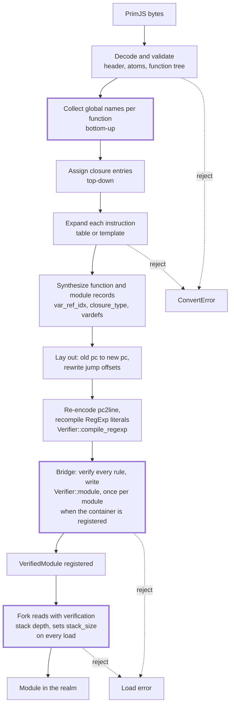

# Converting PrimJS bytecode to this engine's QuickJS bytecode

Investigation and design evaluation, 2026-11-10; all of §11 was built the
same day, and §9 says what has been shown to work. The rulings are in §10;
the rest is what the two formats are, how one is rewritten into the other,
what that costs, and where it would sit in this engine.

Revisions compared: `lynx-family/primjs` at `941a365` (2.11.1-rc.1) and
`vendor/quickjs` at `3d6832a` (the `lynx` series on bellard/quickjs
`2026-06-04`, `BC_VERSION 5`). PrimJS paths below are relative to
`src/interpreter/quickjs/` in that repository; fork paths are relative to
`vendor/quickjs/`.

## 1. Why, and what is in scope

A native `.lynx.bundle` carries JavaScript as PrimJS bytecode in four places
(`docs/lynx-binary-template.md`): `ROOT_LEPUS` (the main-thread script, always
bytecode when the bundle magic is LepusNG), `LEPUS_CHUNK`, `JS_BYTECODE` and a
custom section whose encoding is `JsBytecode`. `bobcat-source::native` rejects
all four today with `ConvertError::CodeCacheBundle`
(`crates/bobcat-source/src/native/decode.rs`, `reject_top_level_bytecode`),
except three exact byte strings of an empty program. Until 2026-11-10
`AGENTS.md` placed native bytecode execution outside the runtime target;
ruling 1 (§10) makes it one. A converter is the only way to run such a bundle
on this engine without embedding PrimJS, because the bundle does not carry the
source. All four places hold the output of one serializer (§2.5), so one
converter covers the main thread and the background thread.

Scope of this document:

- **ECMAScript-conformant execution only.** PrimJS's `no_lepus_strict_mode`
  (a property read on `null`/`undefined` answers `null`,
  `source/quickjs.cc:8368`) is a context switch, not something the bytecode
  records, and is not considered.
- **Not in place.** Instruction lengths and function records may change; the
  output is a new buffer.
- **One direction**: PrimJS bytes in, bytes the pinned fork's `JS_ReadObject`
  accepts out.

## 2. The PrimJS format

### 2.1 Header and version rule

`JS_WriteObjectAtoms` (`source/quickjs.cc:32734`) writes:

| Field | Encoding | Meaning |
| --- | --- | --- |
| version | u8 | `9` (`BC_VERSION + BC_NEW_PREFIX`) when the compile context has a target SDK of 2.14 or later, else `1` (`BC_VERSION`); §2.5 says when the context has one |
| primjs version | u64 LE, only when version is `9` | low 32 bits `(OP_SHIPPABLE_COUNT + 16 + JS_ATOM_END - 1) \| 0xCAB00000`; bit 32 `NEW_DEBUGINFO_FLAG`; bit 33 `STRIP_VARINFO_FLAG` |
| atom count | leb128 | number of atoms that follow |
| atoms | per atom: leb128 `len << 1 \| is_wide`, then bytes or u16 units | every atom that is not built in |

The reader (`JS_ReadObjectAtoms`, `:33866`) refuses one case only: a low-32
value greater than its own (`JS_CheckBytecodeVersion`). A newer runtime reads
older bytes; nothing is negotiated.

The three empty-program fingerprints in `decode.rs` decode exactly this way,
which checks the reading above against bytes a real encoder wrote.
`EMPTY_ROOT_LEPUS_EXTERNAL_DEBUG` is:

```
09                       version 9
cc 01 b0 ca 01 00 00 00  0x1_CAB001CC: 0x1CC = 460 = 242 + 16 + 202, NEW_DEBUGINFO
00                       0 atoms
0d                       BC_TAG_FUNCTION_BYTECODE (13)
00 06                    flags: arguments_allowed, has_debug
00                       js_mode
9e 01                    func_name: built-in atom 79 "<eval>"
00 01 00 01 00 00 02     arg 0, var 1, defined_arg 0, stack 1, closure 0, cpool 0, bytecode 2
01 a0 01 00 00 00        1 vardef: atom 80 "<ret>", scope_level 0, scope_next -1, flags 0
c2 28                    get_loc0; return
5e 01 00                 debug: filename atom 47 "", function id 1, pc2line length 0
```

The tasm 0.0.53 fingerprint has `ca 03` in the version word (both flags) and
a vardef count of 0, which is `STRIP_VARINFO_FLAG` doing what §2.3 says. The
count of 202 built-in atoms also settles one build fact: the shipping encoder
is built without `CONFIG_ATOMICS` (`include/quickjs-atom.h:172` guards three
atoms), so the built-in table has 202 entries, not 205.

### 2.2 How compatibility is kept

By freezing, in three places:

- **Opcodes.** `static_assert(OP_SHIPPABLE_COUNT == 242, "changing the shipped
  opcode count breaks bytecode ABI")` (`include/quickjs-inner.h:997`). The one
  opcode past it, `inc_coverage`, is refused by the writer and the reader.
- **Built-in atoms.** With bytecode allowed, `first_atom = JS_ATOM_END`
  (`:32815`, `:33943`): an atom below it is written as its raw index. Adding,
  removing or reordering a built-in atom would change what old bytes mean, so
  the table cannot change.
- **Record layout.** Optional parts are gated by the two header flags and by
  the bundle's target SDK version, never by reinterpreting a field.

For a converter this means one source dialect with two flags.

### 2.3 Function record

`JS_WriteFunction` (`:32435`), in order: u16 flags (`has_prototype`,
`has_simple_parameter_list`, `is_derived_class_constructor`,
`need_home_object`, `func_kind`:2, `new_target_allowed`, `super_call_allowed`,
`super_allowed`, `arguments_allowed`, `has_debug`); u8 `js_mode`; atom
`func_name`; leb128 `arg_count`, `var_count`, `defined_arg_count`,
`stack_size`, `closure_var_count`, `cpool_count`, `byte_code_len`; leb128
vardef count (0 when stripped) and per vardef atom, `scope_level`,
`scope_next + 1`, u8 flags; per closure variable atom, `var_idx`, u8 flags
(`is_local`, `is_arg`, `is_const`, `is_lexical`, `var_kind`:4); the bytecode
with atom operands rewritten to file indices; when `has_debug`, either
(external debug info) filename atom, function id, `0`, or (inline) filename
atom, `line_num`, pc2line length and bytes; then the constant pool, each entry
a tagged value.

On the wire the debug block is the same four fields in every form (atom,
leb128, leb128 length, bytes). Three meanings occur: inline (filename, line,
pc2line); external with a version-`9` header (filename, function id, length
0); and external with a version-`1` header, where the filename atom is the
fixed string `__lepusNG_function_id__`, the second field is the function id
and the length is 0 (the reader's `debuginfo_outside == 2` branch,
`source/quickjs.cc:33509`). A vardef's `scope_next` can be -2, written through
an unsigned field as `0xFFFFFFFF`; it occurs in real bundles.

Vardefs are stripped when the bundle is LepusNG with external debug info and a
target SDK of 4.1 or later, except in a function with a direct `eval`
(`JS_ShouldStripVarInfo`, `:32394`).

### 2.4 What its reader validates

`JS_ReadFunctionBytecode` (`:33168`) checks every instruction: opcode below
`OP_SHIPPABLE_COUNT`, instruction inside the buffer, and each local, argument,
closure-variable and constant-pool operand inside its count.
`JS_ValidateChildClosureVars` (`:33294`) checks each child's closure indices
against the parent's counts. It does not check stack depth or jump targets.

### 2.5 Main-thread and background-thread sections are one format

Ruling 1 asked whether the background thread's bytecode is the same format as
the main thread's. It is. In `lynx/` (at `66b002855`):

| | `ROOT_LEPUS`, `LEPUS_CHUNK`, `JsBytecode` custom section | `JS_BYTECODE` |
| --- | --- | --- |
| Thread | main | background |
| Written by | `LEPUS_WriteObject(…, LEPUS_WRITE_OBJ_BYTECODE)` on the LepusNG context's top-level function (`core/runtime/lepus/context_binary_writer.cc:67`; a custom section goes through the same writer, `template_binary_writer.cc:245`) | `LEPUS_Eval(COMPILE_ONLY \| TYPE_GLOBAL)` then the same `LEPUS_WriteObject` (`core/runtime/js/bytecode/quickjs/quickjs_cache_generator.cc`, `CompileJS`) |
| Read by | `LEPUS_EvalBinary` (`core/runtime/lepusng/quick_context.cc:1117`) | `LEPUS_EvalBinary` (`core/runtime/js/jsi/quickjs/quickjs_helper.cc:259`) |
| Program kind | global script | global script |
| Wrapper | a `u64` length | 24-byte packed header |

The packed header (`core/runtime/js/bytecode/quickjs/bytecode/quickjs_bytecode.h`)
is six little-endian `u32`: magic `0xD8C54E17`, header version `1`, bytecode
offset, bytecode size, target SDK major, target SDK minor. Lynx checks that
offset plus size equals the buffer length and that the target SDK is not newer
than the runtime (`quickjs_runtime.cc`, `PrepareJavaScriptBytecode`); the
reader does the first and ignores the second. The `JS_BYTECODE` section's
engine type field is `2` (`JSRuntimeType::quickjs`, `core/runtime/js/jsi/jsi.h`).

What differs between sections is which of §2's options the encoder picks, not
the format. Encoding the corpus of §7 with `@lynx-js/tasm` 0.0.53 gave:

| Encoder options | `ROOT_LEPUS` | `JS_BYTECODE` |
| --- | --- | --- |
| target SDK 2.13, `debugInfoOutside: true` | version `1`; debug blocks in the `__lepusNG_function_id__` form | version `1`; no debug blocks |
| target SDK 2.14, `debugInfoOutside: true` | version `9`, `NEW_DEBUGINFO_FLAG` | version `9`, `NEW_DEBUGINFO_FLAG` |
| target SDK 4.1, `debugInfoOutside: true` | version `9`, `NEW_DEBUGINFO_FLAG`, `STRIP_VARINFO_FLAG` | as for 2.14 |
| target SDK 4.1, `debugInfoOutside: false` | version `1`; inline debug blocks with pc2line | as for 2.14 |

The main-thread compile gives its context a target SDK only when
`debugInfoOutside` is on, which is why its version byte follows that option as
well as the SDK. Version `9` with inline debug info could not be produced, and
`STRIP_VARINFO_FLAG` never appeared in `JS_BYTECODE`. The reader accepts every
combination the format allows, including those.

## 3. The fork's format, and where it differs

`JS_WriteFunctionTag` (`quickjs.c:38336`), `JS_WriteModule` (`:38425`), tags
at `:37994`.

| Item | PrimJS | Fork | Kind of change |
| --- | --- | --- | --- |
| Header | version, optional u64, atoms | u8 `5`, atoms | rewrite |
| Value tags | `BIG_FLOAT` = 11, then `TEMPLATE_OBJECT`, `FUNCTION_BYTECODE`, `MODULE` | no `BIG_FLOAT`; those three are one lower; six more tags after | table |
| Built-in atoms | 202 | 244 definitions; all 202 present by string, 47 at the same index | table |
| Opcodes | 242 | 244; 228 names shared, 65 at the same number (numbering diverges at 44) | table, plus §4.4 |
| Global access | `get_var`/`put_var`/… carry an atom (5 bytes) and look the global up on each execution | carry a closure index (3 bytes); the binding is resolved when the closure is created (`js_closure2`, `:17527`) | whole function tree, §4.3 |
| Global declarations | `check_define_var`, `define_var`, `define_func` instructions in the script prologue | closure variables of type `JS_CLOSURE_GLOBAL_DECL` | whole function tree, §4.3 |
| Function flags | 11 bits | adds `is_direct_or_indirect_eval` | synthesize |
| Counts | as §2.3 | adds `var_ref_count` before `closure_var_count` | synthesize |
| Vardef | `scope_level`, `scope_next`, u8 flags | no `scope_level`; adds `var_ref_idx` and the `has_scope` flag | synthesize |
| Closure variable | u8 flags with `is_local`, `is_arg` | u16 flags with a 3-bit `closure_type` (`:630`) | map |
| Debug block | optional `line_num` field; pc2line of packed line/column words | no `line_num`; pc2line opens with line and column; then `source_len` and source | re-encode |
| `js_mode` | strict = bit 0, strip = 1, bigint = 2, math = 3, async = 4 | strict = bit 0, async = 2, backtrace barrier = 3 | map |
| Module record | names, exports, star exports, imports | adds import attributes per request, `is_star` per import, `has_tla` | synthesize |
| RegExp literal | pool string holding libregexp bytecode: 7-byte header, 29 opcodes | 8-byte header, register-based, 45 opcodes | recompile, §4.9 |
| Strings, BigInt payload, int32, float64 | | identical | copy |

Opcodes PrimJS has and the fork does not (14 shippable): `throw_var`,
`get_super_ctor`, `check_var`, `put_var_strict`, `define_var`,
`check_define_var`, `define_func`, `to_propkey2`, `with_get_ref_undef`,
`iterator_close_return`, `async_iterator_close`, `async_iterator_next`,
`async_iterator_get`, `is_function`.

Shared names whose size or stack effect differs (6): `eval`, `import`,
`get_var_undef`/`get_var`/`put_var`/`put_var_init` (one row above),
`iterator_get_value_done`, `yield_star`.

## 4. Conversion design



The marked steps are the ones that are not a per-instruction rewrite: C needs
the whole function tree, and V and H together are what makes the output safe
to run (§4.7). Everything down to I is the converter, in `bobcat-source`; V is
in the bridge crate, in Rust, and runs once per converted module, when its
container is registered; H is in the fork, and runs each time a realm compiles
the module.

### 4.1 Decode

A reader for §2, with PrimJS's own checks (§2.4) plus the ones it lacks: every
jump target is an instruction start inside the function, every atom operand is
a built-in index or inside the file's atom table, recursion depth and section
length are bounded as the other `bobcat-source` parsers are. Input that fails
is an error, never a partial result.

### 4.2 Tables

Three tables: built-in atom index to atom string (PrimJS, frozen, 202
entries), opcode number to (name, size, operand format, pops, pushes) for each
side, and value tags. The PrimJS tables are written once into the converter.
The fork's are generated at build time from `quickjs-atom.h` and
`quickjs-opcode.h`, which `crates/quickjs-rust-bridge/build.rs` already lists
as inputs, so a fork rebase regenerates them.

A built-in PrimJS atom becomes the fork's built-in index for the same string.
A file atom becomes the fork's built-in index if the fork has that string
built in, as the fork's own writer would emit it, else an entry of the output
atom table.

### 4.3 Globals

For each function `f`, `need(f)` is the set of atoms its own instructions name
through `get_var`, `get_var_undef`, `put_var`, `put_var_init`, `check_var`,
`put_var_strict`, `define_var`, `check_define_var`, `define_func`, unioned
with `need` of every function in its constant pool. One post-order walk
computes it.

A pre-order walk then appends entries to each function's closure table:

- the top-level function gets one `JS_CLOSURE_GLOBAL` per atom, or
  `JS_CLOSURE_GLOBAL_DECL` when the prologue declares it, with `is_lexical`,
  `is_const` and `var_kind` (`JS_VAR_GLOBAL_FUNCTION_DECL` for `define_func`)
  taken from the instruction's flags byte;
- every other function gets one `JS_CLOSURE_GLOBAL_REF` per atom, whose
  `var_idx` is the atom's index in its parent's table.

Entries are appended, so existing closure indices in the bytecode and in
children stay valid. §6 refines the top-level function's entry types, because
the output is a module. Each instruction's atom operand is replaced by the
function's index for that atom.

The number of entries added, `C = Σ |need(f)|`, is what the fork's own
compiler emits for the same program (`resolve_scope_var`, `:33709`); it is not
converter overhead. A function may hold at most 65534 closure variables
(`JS_MAX_LOCAL_VARS`); beyond that the file is rejected.

One behavior follows the fork rather than PrimJS: a global binding is resolved
once per closure instead of on every access. That is how the fork runs source
it compiled itself.

### 4.4 Instruction expansion

As built, 210 of the 242 opcodes copy by name, 25 are translated and 7 are
refused (`convert/classify.rs`; a test checks every opcode is in exactly one
class and that each copied one has the same pops, pushes and operand format in
both tables). The translations, each a fixed sequence that depends on the
instruction alone except where noted:

| PrimJS | Fork sequence | Note |
| --- | --- | --- |
| `get_var`, `get_var_undef`, `put_var`, `put_var_init` atom | same name, closure index | §4.3 |
| `check_var` atom | `undefined` | keeps the stack slot `put_var_strict` expects |
| `put_var_strict` atom | `nip; put_var idx` | the fork's `put_var` raises the strict-mode `ReferenceError` itself (`:18762`) |
| `check_define_var`, `define_var` | nothing | become closure entries |
| `define_func` atom | `put_var_ref idx` | as the fork's `instantiate_hoisted_definitions` (`:34478`) |
| `throw_var` | `throw_error` | type codes 0 to 3 are equal |
| `get_super_ctor` | `get_super` | the fork tests for a constructor at the call, after the arguments, which is the specification's order |
| `to_propkey2` | `swap; dup; is_undefined_or_null; if_false L; get_length; L: swap; to_propkey` | `get_length` on `null`/`undefined` raises the `TypeError` |
| `is_function` | `typeof_is_function` | |
| `import` | refused | the mapping would be `undefined; import`, but no corpus program exercises it, and nothing is converted that no test executes |
| `iterator_close_return` | `nip_catch; rot3r; undefined` | as the fork's `emit_return` (`:28704`) |
| `async_iterator_next` | `iterator_next` | same stack contract |
| `async_iterator_get 0`, `1` | `iterator_call 0`, `1` | |
| `async_iterator_get 2` | `throw_error NULL, ITERATOR_THROW` | PrimJS's raises the same `TypeError` inline |
| `async_iterator_close` | `drop; drop; get_field2 return; dup; is_undefined_or_null; if_true A; call_method 0; push_false; goto B; A: drop; drop; undefined; push_true; B:` | |
| `yield_star` (sync) | the fork's delegation loop | below |
| `iterator_get_value_done` | `iterator_check_object; get_field2 done; swap; get_field value; swap` | below; kept by name only in the `for await` head |
| `dup3; drop; call_method 0; await; iterator_get_value_done` (the `for await` head) | `for_await_of_next; await; iterator_get_value_done` | the one translation that matches a sequence: `dup3` copies the iterator marker, which the rules refuse |
| `apply` magic 0, 1 | same | any other magic is refused: the fork gives 2 another meaning |
| `regexp` | same, with its bytecode operand recompiled | §4.9 |
| `if_false8`, `if_true8`, `goto8`, `goto16` | the 32-bit forms | §4.6 |

**`yield_star`.** PrimJS compiles a synchronous `yield*` as `for_of_start;
drop; yield_star` and its runtime performs the delegation
(`JS_GENERATOR_STATE_SUSPENDED_YIELD_STAR`, `source/quickjs.cc:17719`): the
instruction is entered with `[iter, next]` on the stack and is left with
`[value, is_return]`, which the following `if_false` tests. The fork compiles
the delegation as a loop of `iterator_next`, `iterator_check_object`,
`yield_star`, `iterator_call` (`quickjs.c:28340` onward). The template is that
loop, entered with `[iter, next]`, with its inline return replaced by
`push_true` and its normal exit followed by `push_false`, so it is left with
the same two values. No surrounding instruction is inspected.

**Resume values.** After a plain `yield`, PrimJS pushes
`Bool(magic == RETURN)` and the fork pushes `Int32(magic)` with next = 0,
return = 1, throw = 2 (`:21371`); a throw raises in both. Compiled code tests
the value with `if_false`, which reads both the same way. Async generators
push `Int32(completion_type)` on both sides.

**`iterator_get_value_done`.** The fork's helper additionally stores the
iterator marker into the slot below the result object (`:17012`); PrimJS's
does not. In PrimJS's async-generator `yield*` that slot has deliberately been
replaced by `undefined`, so keeping the name would re-arm the marker and the
unwinder would later call the inner iterator's `return()` where PrimJS and the
specification do not. The instruction is therefore expanded to PrimJS's exact
contract (a `TypeError` for a non-object, `done` read before `value`), except
in the rewritten `for await` head, where the fork's instruction is the right
one. That rewrite changes one behaviour toward the specification: a `next()`
that throws or rejects no longer triggers `iterator.return()`.

**What the semantic audit found.** Every opcode with the same name on both
sides was compared case by case in the two interpreters: 199 have the same
contract, 17 differ in ways that cannot change conformant code (mostly the
fork following the specification where PrimJS did not), and 12 matter, all
handled above or refused. Three differences cannot be absorbed by a converter
and are accepted:

- a spread call (`f(...a)`, `new F(...a)`, `super(...a)`) with more than 65534
  elements throws `RangeError` on the fork; PrimJS has no limit;
- for a strict assignment to an undeclared name, the `ReferenceError` is
  raised at the assignment, after the right-hand side has run, where PrimJS
  raised it before;
- PrimJS's runtime starts a `yield*` delegation with the kind of the call that
  resumed the generator, so a `yield*` inside `finally` during `return()` calls
  the inner `return` first; the converted loop calls `next`, as the
  specification says.

**PrimJS compiler errors the converter cannot repair.** Matching PrimJS where
PrimJS is wrong is not a goal (ruling 9): wherever the converter has a choice,
as in the three cases above and the `for await` head, it takes the
specification's behaviour. But the bytecode is what PrimJS's compiler
produced, and where that compiler departed from the source's meaning the
departure is in the instructions, usually in a form that cannot be told from
correct code for other source. The corpus shows five:

| Source | What PrimJS compiled | Why it cannot be put right from bytecode |
| --- | --- | --- |
| `a ?? b` | a test of the left side for `undefined` only | the same instructions as a default value (`{a = b} = o`, `function f(a = b)`), where testing for `undefined` only is correct |
| `(o?.m)()` | a property read, then a call without `this` | the same as calling a function taken out of an object on purpose |
| `delete o?.a` | a property read, a drop, `true` | the same as `(o?.a, true)` |
| a default parameter expression naming a variable the body also declares with `var` | a read of the body's variable | the scope was resolved at compile time; the outer binding is not named anywhere |
| a static field initializer that reads its own class | the read before the class binding is initialized | the order of two instruction groups, with nothing marking them as one class definition |

A bundle that needs these to behave as written has to be shipped in source
form. The differential test asserts each of the five with its outcome, so a
change in either direction is noticed.

### 4.5 Function records

- `closure_type`: `is_local && is_arg` → `JS_CLOSURE_ARG`; `is_local` →
  `JS_CLOSURE_LOCAL`; else `JS_CLOSURE_REF`; plus the entries of §4.3.
- `var_ref_idx`, `var_ref_count`: number the captured arguments and locals of
  a function from 0. Captured is recomputed, not taken from PrimJS's flag: a
  variable some child's closure table names as `LOCAL` or `ARG`, the operand
  of `make_loc_ref`, `make_arg_ref` and `close_loc`, and every argument of a
  function that builds a mapped `arguments` object (`special_object 1`), which
  the fork fills through each argument's variable reference.
- A closure variable whose name was stripped takes its name from the parent's
  vardef or closure entry, or failing that the text the fork prints for an
  unnamed variable; the null atom is not a legal name there.
- Vardefs: the fork's `get_var_ref` reads `vardefs[i].var_ref_idx`
  (`:17262`), so a function whose vardefs were stripped gets a synthesized
  array of `arg_count + var_count` entries with `JS_ATOM_NULL` names.
  `scope_next` and `has_scope` are only read by a direct `eval`, which §4.10
  rejects.
- `js_mode`: strict carries over; every other bit is dropped, the async bit
  included. The fork sets `JS_MODE_ASYNC` on a running frame, not in a record:
  in a record it makes a normal frame's variable-reference lookup treat the C
  stack as an async frame, and the verifier refuses it.
- `is_direct_or_indirect_eval`: 0.

### 4.6 Layout

Sizes change (`get_var` shrinks, templates grow). Both models address a jump
by instruction index, so the converter maps indices and the bridge's writer
computes the byte offsets. PrimJS's short jumps
(`if_false8`, `if_true8`, `goto8`, `goto16`) are widened to their 32-bit forms
first; then one pass assigns addresses and a second writes offsets, with no
relaxation loop. The cost is a few bytes per short jump.

### 4.7 Verification: what the fork's interpreter assumes

The fork's reader does not verify bytecode, and its interpreter assumes the
bytes came from its own compiler: `Runtime::register_module_bytecode`
documents that only bytes this process or its build wrote belong there.
Converter output is written by this process from untrusted input, so before
any of it runs, every property the interpreter assumes has to be established.

**Stack depth (ruling 6: exported from the fork).** The fork's compiler
contains `compute_stack_size` (`:36226`): a worklist over the final bytecode
that records one stack depth and one catch position per reached instruction,
follows every branch kind (`if_*`, `goto*`, `gosub`, `catch`, the `with_*`
family), rejects an inconsistent depth, an underflow, a depth above
`JS_STACK_SIZE_MAX` and a jump outside the buffer, and yields the maximum
depth. It is `static`, but of its `JSFunctionDef` argument it reads only the
bytecode buffer and length. The fork patch splits the body into a function
over `(buffer, length)` and reaches it from a read flag, `JS_READ_OBJ_VERIFY`,
that runs it on each function read and stores the result as that function's
`stack_size`. The converter therefore writes no stack size of its own.

The same flag makes the reader itself safe to call on arbitrary bytes, which
it was not: its instruction walk indexed the opcode table with any byte and
read operands past the buffer, counts were used before being compared with the
input, a vardef count other than `arg_count + var_count` led to out-of-bounds
access later, and a module that failed to read stayed on the context's module
list. Under the flag each of these is a failed read, only the value kinds
compiled code contains are accepted, and a module record's indices are checked
against their tables. Without the flag the reader behaves as before.

**The function alone is not enough for hostile input.** It was written to
size a frame for code the compiler just produced, and it relies on that
compiler's habits. The interpreter assumes far more of its input than stack
depth: that the value `ret` pops is an address a `gosub` pushed (the source
comments "should have a different tag to avoid security flaw"), that a
catch offset stays in the slot where it was pushed, that `fclosure`'s pool
entry is function bytecode, that `regexp` receives bytecode the engine
compiled, that generator instructions run only in generator frames, that
enumerated operands are in range, and so on.

**The rules live in Rust, in the bridge (ruling 8).**
`quickjs_rust_bridge::bytecode` holds a model of the fork's format, a reader, a
writer and the verifier, whose one public entry is `Verifier`. Its module
documentation carries the rules table (32
rules, each with what the interpreter would do without it) and is the
reference; this section only summarizes. The verifier walks each function's
control flow along the same edges as `compute_stack_size`, plus the edge from
`ret` back to each `gosub`, and keeps per reached instruction the depth, the
kinds of the slots that are not plain values, the locals that can hold the
uninitialized marker, and a copy of the fork walk's own depth and catch
position. The rule classes:

- **Stack and slots**: depth, merges, return addresses, catch offsets,
  iterator markers and raw function bytecode on the stack.
- **Frames**: which instructions may run in normal, generator, async and
  module-linking frames.
- **Liveness**: `catch`, `gosub` and `with_*` jump forward only, because the
  interpreter polls its interrupt handler only on `goto`, `if_*` and calls, and
  a loop closed any other way cannot be stopped by an execution limit.
- **Leaks**: three iteration instructions overwrite or drop a slot without
  freeing it, so the slot must hold the marker or a known `undefined`; a leak
  is an abort when the runtime is freed.
- **The uninitialized marker**: a value read without a check from a variable
  that can hold the marker is tracked, and only instructions that test its
  tag may take it.
- **Operands, records and module records**: ranges, enumerations, closure
  types by position, captured-variable indices, global bindings, the module
  function's shape.
- **Regular expressions**: the bytecode string of a `regexp` must equal what
  the engine compiles for the pattern and the flags in its header. The
  compiler is the `Verifier`'s own: a runtime and a realm with only the
  engine's basic objects (`JS_NewContextRaw`), made on the first literal it
  compiles, with every compilation kept by pattern and flags for the
  verifier's lifetime. The trait the rules take a compiler through is private
  to the bridge, so no caller can supply a compiler that answers arbitrary
  bytes for a pattern.

`Verifier::module` checks a program against the rules and writes it;
`Verifier::module_from_bytes` reads bytes first. Either answers a
`VerifiedModule`: the bytes the bridge's writer wrote for a program the
verifier accepted, a value with no other constructor.
`Context::complete_module_bytecode` and the synchronous loader's
`RequiredBody::ModuleBytecode` take only a `VerifiedModule` and hand its bytes
to the fork's verifying read as they are, so the C reader sees exactly the
program that passed, and no caller can load module bytecode that skipped the
rules. `Context::verify_bytecode`, for tooling and tests, runs the same rules
with the realm's own compiler on bytes of any root. The converter builds its
output through the same model and hands it to `Verifier::module`, so its
output is checked once, before it is written.

How the rules were arrived at: a first list from reading the interpreter;
then every opcode case and every consumer of a record field was read and
tabulated; then mutated bytecode that passed the checks was executed, and each
crash, abort or hang became a rule with a regression test. Six holes were
found that way (a value dropped without being freed by `for_await_of_next`, a
module's linking frame left with references open, a backward `catch` that no
execution limit could stop, `define_class` without a parent over a live
object, a global declaration named by the null atom, an initializing store
into an undeclared global's parked reference). With the final rules, 7.3
million mutants, 2.6 million of them executed, and 150 thousand under
AddressSanitizer ran without a fault; every program the fork compiles from the
corpus, the bridge's tests and 12,700 files of `node_modules` is accepted.

What the rules do not cover is listed at the end of that module's
documentation: a direct `eval`'s record flags, regexp bytecode beyond equality
with the engine's own output, and an out-of-memory failure inside a module's
linking prologue (which the fork's own compiler output has too).

### 4.8 Debug information

PrimJS's pc2line is a delta table whose values pack line and column into one
word in two variants (`source/quickjs.cc:7749`); the fork's opens with
leb128 line and column and continues with deltas (`:35019`). Decode, map each
pc, encode; PrimJS's columns count from 1 and are written as they are. A
bundle with external debug info has an empty table; the function id it carries
instead has no place in the fork's record and is dropped (ruling 5). Its
functions get a debug block naming the module, with no line table, so a stack
trace from such code has function names and no line numbers.

### 4.9 Constant pool

Nested functions recurse. Template objects, strings, numbers and BigInt copy.

A RegExp literal is `push_const pattern; push_const bytecode; regexp`, emitted
adjacently (`source/quickjs.cc:22568`). The converter requires exactly that
shape (§4.7), reads the flags from the PrimJS regexp header, and replaces the
bytecode string with what the fork compiles for that pattern and flags. This
is the one place the rewrite looks at a neighboring instruction, and the one
place it calls the engine, through the fork's export of the pattern compiler,
`JS_CompileRegExp`. It asks the container's `Verifier`
(`Verifier::compile_regexp`), which keeps each compilation by pattern and
flags, so the `regexp` rule's comparison of the same literal, and every later
literal with the same pattern and flags in any section of the container, costs
no second compilation. A pattern the fork rejects fails the conversion.

### 4.10 What is rejected

Every rejection is a conversion error for the whole section, and so a load
failure of the bundle (ruling 3). There is no partial support.

- **Direct `eval`.** ReactLynx's *development* main-thread runtime contains
  one (its snapshot-patch `evaluate` function), so development builds do not
  convert; production builds do. PrimJS's `eval` takes one argument and no
  callee on the stack (`:15662`); the fork's takes the callee and an argument count, and its
  runtime compiler reads the enclosing function's scope metadata in the fork's
  own encoding (`ARG_SCOPE_END`, `has_scope`). `with_get_ref_undef` exists
  only for the variable object such a function creates and goes with it.
- **`BIG_FLOAT`** values.
- **`BC_TAG_MODULE` input** (ruling 4). PrimJS's module record predates
  top-level await and import attributes, and both threads' sections are
  global scripts (§2.5).
- **Opcodes at or above `OP_SHIPPABLE_COUNT`**, as PrimJS's own reader does,
  and `nip1`, `for_await_of_next` and `nop`, which PrimJS's compiler cannot
  emit; dynamic `import()`, which no test exercises.
- **Byte-swapped input** (version bit `0x40`), and any header bit this
  document does not name.
- **More than 65534 closure variables** in one function after §4.3.
- **Anything §4.7 refuses.**

## 5. Complexity

Let `N` be the input size in bytes and `C` the closure entries of §4.3.

| Step | Time | Extra memory |
| --- | --- | --- |
| Decode, validate | O(N) | O(N) for the function tree |
| Global collection and assignment | O(N + C) | O(C) |
| Instruction expansion | O(N) | O(N) |
| Function records | O(variables) | O(variables) |
| Layout | O(N) | one `u32` per input byte |
| pc2line | O(N) | O(table) |
| RegExp | one compile per literal | |
| Write | O(N + C) | output buffer |
| Rules pass (bridge) | O(N + S), `S` the non-plain slots live at each reached instruction, summed; kinds are kept as a sparse list, which try/finally and iteration nesting bound | that list per reached instruction |
| Verification on read (fork) | O(N); each reached instruction is visited once | a depth and a catch position per output byte, freed after the read |

Total: O(N + C) time, O(N + C) memory, in a fixed number of passes. `C` is
bounded by (nesting depth) × (distinct globals) and equals what the fork's own
compiler would produce. Nothing has been measured; there is no number here for
conversion time or output size.

The algorithm is not where the cost is. It is in four other places:

1. **The same-name opcodes.** 222 instructions are mapped by name on the
   assumption that the two interpreters agree. The ones read side by side for
   this document (`apply`, the `with_*` family, the iterator family, `eval`,
   the global family, `yield`/`yield_star`, `get_super`) turned up the
   differences listed in §4.4, each of which could be absorbed. The others
   have not been compared.
2. **The interpreter's assumptions.** §4.7's table has ten rows from a partial
   read. Each opcode case has to be read once more for what it takes on trust.
3. **A reference to test against.** A semantic difference shows only when the
   same program is run both ways (§7), which needs a PrimJS build that can
   write bytecode (ruling 7).
4. **The fork moves.** The source side is frozen; the target side has no
   compatibility promise. Tables regenerate, but each template names fork
   instructions whose meaning a rebase can change, as the iterator family did,
   and the verification patch has to be carried across each rebase.

## 6. Where it sits in this engine

**Code.** The converter is bytes to bytes with no unsafe code, which fits
`bobcat-source`: it is the owner of Lynx source adaptation, it forbids unsafe,
and its `native` module is where the bytecode is found and rejected today.
The fork-side tables, the regexp compile entry and the verifying read belong
to `quickjs-rust-bridge`, which owns the C build. `bobcat-source` depends on
`bobcat-core`, which depends on the bridge, so no new crate edge is needed.

**A converted section is a module (ruling 2).** In native Lynx each section is
a global script whose runtime names are globals of its context. In this
engine every card body is an ES module whose first line imports those names
(`MTS_CHUNK_PREAMBLE`, `BTS_CHUNK_PREAMBLE`), and a global-props update
replaces a live module binding. The converter keeps that contract.

The fork runs a module function twice, once in a normal frame to link
(`this === true`) and once as an async function to evaluate, and requires it
to be strict; the verifier holds it to the compiler's shape for both. A
script's top-level function is a normal, possibly sloppy function that returns
a completion value, so it is not turned into the module function. The module
function is a fixed sequence written by the converter, and the converted
script function is its one child:

```
push_this; if_false L; return_undef        ; linking: nothing to initialize
L: get_var globalThis                      ; a script's top-level `this`
   fclosure <converted script function>
   call_method 0                           ; the completion value
   <store to the default export, or drop>
   undefined; return_async
```

This keeps the script's own strictness, its `this`, and its `return`s as they
are. The module function owns the top-level closure table, and the script
function reaches it through closure references (§4.3 with one more level):

| Free name in the PrimJS script | Module function's entry | Reached from the script by |
| --- | --- | --- |
| imported by the realm's preamble | `JS_CLOSURE_MODULE_IMPORT`, with an import entry and a module request (`bobcat:runtime`, `bobcat:element`, `bobcat:bts-runtime`) | `JS_CLOSURE_REF`; reads are `get_var_ref_check`, a write is the read-only error |
| one the background preamble declares `undefined` (`window`, `document`, …) | a module-local constant initialized to `undefined` | `JS_CLOSURE_REF`, as above |
| declared by the script itself (`define_var`, `define_func`) | `JS_CLOSURE_GLOBAL_DECL`: a script's top-level declarations are properties of the global object, and other sections may read them | `JS_CLOSURE_GLOBAL_REF` and the `get_var`/`put_var` family |
| anything else | `JS_CLOSURE_GLOBAL` | `JS_CLOSURE_GLOBAL_REF` and the `get_var`/`put_var` family |

A name the script declares wins over the preamble's list. The preamble lists
are `bobcat-core`'s constants; the converter takes the names from them and
holds no copy.

One difference from a script follows: global declarations are instantiated
when the module's closure is created, at link time, not when the script
starts to run, and a redeclaration error is a link failure.

The completion value becomes the default export for a `main-thread` section
and for a Lynx-target background body, as the source path does
(`export default <body>`, `crates/bobcat-source/src/page.rs`,
`bts_module_source`), and is dropped for a root entry.

A named Lepus chunk has to run again on every `__LoadLepusChunk` call, and a
module evaluates once. For such a section the module function does not call
the script: it stores the script function itself as the default export
(`Completion::ExportScript`), and `__LoadLepusChunk` calls that export with
`this` set to the global object each time.

**Where conversion runs (built, §11 step 5).** In `bobcat-source`, when a
container is built from a native bundle (`ContainerSources`), before
anything is registered: the crates below it (`bobcat-core`,
`bobcat-resources`) cannot call the converter, and they learn only "a verified
module for the fork", never "PrimJS". Each bytecode section is converted with
the URL it is registered under as its module name, checked and written by the
container's one `Verifier`, and registered as the `VerifiedModule` that
answers; `docs/source-architecture.md` has the section table. The verifier
also compiles the regular expression literals the converter needs (§4.9); its
engine is made on the first literal, so a container whose sections carry none
makes none. A section that fails to read, convert or verify fails the
container, which fails the page's load or the lazy bundle's fetch with the
reason. `native::decode` and `native::convert`, the path of the tool that
writes a `.web.bundle`, keep refusing bytecode: that format has no place for
it.

The path of the module after that, as the one `VerifiedModule` value (its
bytes are shared, not copied, until a realm keeps them):
`Registrar::register_module_bytecode` → `LoadedSource::ModuleBytecode` →
`Context::complete_module_bytecode` for an entry or an `import()`, or the
synchronous loader's `RequiredBody::ModuleBytecode` for a `require` and for an
import linked inline. No Rust check runs on this path: the realm keeps a copy
of the bytes, and the fork reads them with `JS_READ_OBJ_VERIFY` when the module
is compiled; reading at that point, not on arrival, is what lets a running
module body `require` a bytecode module. A refusal by that read is a
`SyntaxError`, `bytecode rejected for '<url>': <reason>`.

**Bridge and fork additions (built, §11 step 2).**

1. `quickjs_rust_bridge::bytecode_abi`: the opcode table, the built-in atom
   table and the format's enumerations, generated by the bridge's build script
   from the fork's headers and `quickjs.c`. Each generated value has a
   `_Static_assert` compiled in the same unit as `quickjs.c`, and a test
   compares the atom table with a new runtime's, so a fork rebase that
   renumbers anything fails the build or that test.
2. Fork: `JS_CompileRegExp`; bridge: `Context::compile_regexp_bytecode`, which
   takes the pattern as UTF-16 code units because a lone surrogate compiles
   differently from U+FFFD.
3. Bridge: `bytecode::Verifier` (`new`, `compile_regexp`, `module`,
   `module_from_bytes`), which owns the regexp compiler the rules use, in a
   realm the shim makes with `JS_NewContextRaw`; and `bytecode::VerifiedModule`,
   which only the verifier constructs, and which is `Send + Sync` and shares
   its bytes when cloned.
4. Fork: `JS_READ_OBJ_VERIFY` (§4.7); bridge: `Context::complete_module_bytecode`
   and the synchronous loader's `RequiredBody::ModuleBytecode`, which supply a
   realm-local module from a `VerifiedModule`. The bytes are kept as they are,
   and the fork reads them with the flag when the module is compiled.
   `Runtime::register_module_bytecode` is unchanged and still for build-time
   bytes only.
5. For tooling and tests: `Context::compile_script_bytecode` and
   `Context::verify_bytecode`.

The fork changes are two commits on top of the `lynx` series.

A module's name is part of its bytes: it is what the realm's module list
holds and what its relative imports resolve from. The converter writes the
name the module will be registered under.

**Caching.** Conversion output depends on the input bytes, the name it is
registered under, and the fork build. It can be kept under a key of those
(content hash, name, engine build identity), so a bundle is converted once
per engine build. Bytes read back from such a cache become a `VerifiedModule`
only through `Verifier::module_from_bytes`, which checks every rule again, so
the cache does not have to be trusted.

## 7. Verification plan

- **Fixtures of real bytes.** The three fingerprints already in `decode.rs`,
  then bundles encoded from the repository's ReactLynx fixtures by the native
  encoder (`@lynx-js/tasm`, ruling 7), which produces `ROOT_LEPUS` and, with
  bytecode encoding on, `JS_BYTECODE` from the same sources the `.web.bundle`
  fixtures are built from.
- **Differential execution.** For each program: (a) the fork compiles and runs
  the source; (b) PrimJS compiles it, the converter rewrites it, the fork runs
  it. Outputs must match. test262 is the corpus for language semantics; the
  ReactLynx fixtures are the corpus for what real bundles contain.
- **The verifier accepts the fork's own output.** Everything the fork compiles
  from test262 is written, read back with the verifying flag, and must pass.
  This is what shows the added rules of §4.7 describe the compiler's habits
  and not something stricter.
- **Robustness**, as for the other external-byte parsers: a fixed-seed mutator
  over valid inputs, where every output either fails conversion, fails the
  verifying read, or loads and runs in the fork without a fault.
- **Opcode audit.** One checklist of the fork's opcodes with two columns:
  semantics compared with PrimJS's case, and assumptions read for §4.7.

## 8. Risks

| Risk | Consequence | Mitigation |
| --- | --- | --- |
| A same-name opcode differs in a way no test reaches | wrong result at run time, silently | the audit and test262 in §7 |
| The verification misses an assumption the interpreter makes | memory unsafety from a hostile bundle | the per-opcode audit and the execution of mutated bytecode that passed the checks (§4.7); no module reaches a realm without passing `Verifier` (a `VerifiedModule` has no other constructor), and the fork's verifying read checks each load again |
| The added rules reject code PrimJS's compiler really emits | valid bundles fail to load | corpus of real bundles in §7; each rejection names the instruction and rule |
| A fork rebase changes an instruction a template uses, changes control flow the converter's walk mirrors, or conflicts with the fork patch | conversion output breaks | the differential suite runs in CI against the pinned fork |
| PrimJS ships a new format flag | new bundles rejected | unknown header bits are an explicit error, not a misread |
| Programs rely on `no_lepus_strict_mode` | behavior differs from native Lynx | out of scope by decision (§1) |

## 9. What was and was not verified

Verified by reading the sources: the header and record layouts (and, for
PrimJS, by decoding the fingerprints in `decode.rs`); both opcode tables,
compared mechanically by name, size, stack effect and operand format; both
built-in atom tables, compared by string; the interpreter cases and compiler
emission for the instructions named in §4.4; the generator and async-generator
resume sites; the regexp header layouts; string and BigInt serialization; that
both threads' sections come from one serializer (§2.5); the interpreter
assumptions listed in §4.7; that `compute_stack_size` reads only the bytecode
buffer of its `JSFunctionDef`.

Verified by running code:

- the reader decodes every program of the corpus in every encoder variant and
  both sections, and both pages of the ReactLynx fixtures;
- the verifying read accepts bytecode the fork compiled and reproduces the
  compiler's stack sizes; the generated tables equal the compiled engine's;
- the rules accept everything the fork compiles from the corpus and from
  12,700 files of `node_modules`, and mutated bytecode that passes them runs
  without a fault (§4.7);
- of the corpus's 2000 conversions (250 programs, four encoder variants, both
  sections), 1960 leave the result the fork's own run of the source leaves,
  and the other 40 are the five programs of §4.4 that PrimJS's compiler got
  wrong, each asserted with its outcome;
- a template object read from bytecode is frozen, which the fork's reader did
  not do before its third commit here;
- one `Verifier` compiles each regexp pattern and flags once, for the
  converter and the rule together and across a container's sections; a
  verifier that sees no literal makes no engine; its realm with only the basic
  objects compiles and refuses the same patterns as a full realm; one
  `VerifiedModule` completes and runs in realms of two runtimes on two
  threads;
- **real bundles run**: the production ReactLynx fixtures (`react-native`,
  `react-list`, `react-data-processor`, `react-global-props`, `react-reload`,
  `react-lazy`, `react-lazy-sync`, `react-lazy-nested`) boot and pass the
  assertions of their source forms with the main thread as bytecode, and with
  both threads as bytecode, including lazy bundles in bytecode form; the
  development fixtures are refused for direct `eval`, with the reason; four
  hand-written cards (a chunk run twice, a `JsBytecode` custom section, a
  refused lazy bundle, background bytecode) behave as their source forms do.

Not verified: a `<frame>` whose inner card is a bytecode bundle (no fixture;
it goes through the same installer and entry URL); the three accepted
differences of §4.4 by a test (no corpus program shows them); dynamic
`import()`; whether shipped bundles ever use PrimJS's optional bytecode
optimizer (the encoder used here produced identical bytes with its option on
and off); bundles from encoders other than `@lynx-js/tasm` 0.0.53; the fork
commits on test262; any timing or size figure, including the cost of
converting a page on the thread that loads it.

## 10. Rulings

Given by the user on 2026-11-10.

1. **Scope: both threads, if they share one bytecode format; otherwise the
   main thread only.** They share it (§2.5), so `ROOT_LEPUS`, `LEPUS_CHUNK`,
   `JS_BYTECODE` and `JsBytecode` custom sections are all in scope. This
   replaces the earlier position that native bytecode execution is outside the
   runtime target.
2. **Entry shape: a module**, with the names of the preamble's import list
   mapped to module imports (§6).
3. **Unsupported programs fail the load** with a conversion error (§4.10).
4. **PrimJS module input is rejected.**
5. **The external-debug-info function id is dropped.**
6. **The stack check is exported from the fork**, not reimplemented in Rust
   (§4.7).
7. **A PrimJS build may be used as a test-time tool** (§7). It is not linked
   into the engine.


8. **The rules beyond stack depth live in Rust, not in the fork patch.** This
   was asked after ruling 6, because §4.7 found that hostile input needs more
   than `compute_stack_size` checks. As built they are in the bridge crate
   (`quickjs_rust_bridge::bytecode`), which the converter writes through: its
   `Verifier` checks every module once, and `complete_module_bytecode` and the
   synchronous loader take only the `VerifiedModule` it answers; the fork
   patch computes stack sizes and makes its own reader safe on arbitrary
   bytes.
9. **PrimJS's non-conformant behaviour is not a target.** Where the converter
   can choose, it follows the specification (and so the fork), not PrimJS.
   What PrimJS's compiler already got wrong inside the bytecode stays wrong
   (§4.4), because it cannot be recognized there.
10. **Development builds stay refused.** ReactLynx's development main-thread
    runtime uses a direct `eval`; such a bundle fails to load as bytecode, and
    development uses the source form of the bundle, which the engine loads
    today.

## 11. Order of work

All five steps are built. Each stood alone and was useful without the next.

1. PrimJS reader and validator in `bobcat-source`, with a disassembler,
   including the packed header of §2.5 (`native::primjs`).
2. Fork patches: the verifying read (stack depth), the regexp compile export
   and frozen template objects; bridge entries and the generated tables; the
   fork-format model, reader, writer and the rules of §4.7 in the bridge
   (`quickjs_rust_bridge::{bytecode_abi, bytecode}`).
3. The converter, as a module, and the differential test over the corpus
   (`native::primjs::convert`, `tests/primjs_convert.rs`).
4. Templates for generators and async iteration; RegExp recompile; pc2line.
5. Engine integration for both threads: module bytecode as a body kind in the
   resource registry, the core protocol and the bridge's two load paths;
   conversion and registration in `ContainerSources`; the fixture tests run
   over bytecode bundles.

Left for later: a conversion cache (§6); converting a page off the loading
thread; direct `eval`, if development builds are ever to run as bytecode
(ruling 10 says they are not).
