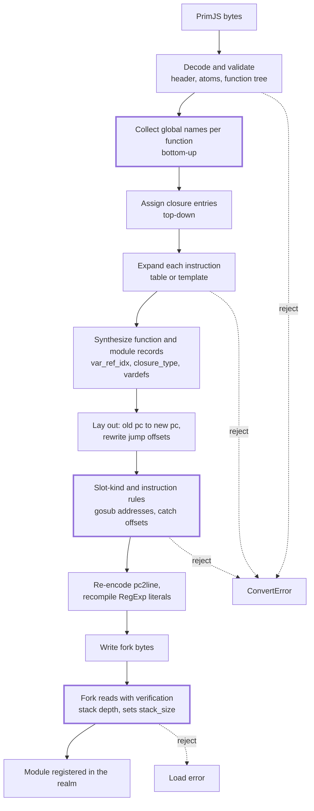

# Converting PrimJS bytecode to this engine's QuickJS bytecode

Investigation and design evaluation, 2026-11-10. Nothing here is built. The
rulings given on it the same day are in §10; the rest is what the two formats are, how one is rewritten into the other,
what that costs, and where it would sit in this engine.

Revisions compared: `lynx-family/primjs` at `941a365` (2.11.1-rc.1) and
`vendor/quickjs` at `3d6832a` (the `lynx` series on bellard/quickjs
`2026-06-04`, `BC_VERSION 5`). PrimJS paths below are relative to
`src/interpreter/quickjs/` in that repository; fork paths are relative to
`vendor/quickjs/`.

## 1. Why, and what is in scope

A native `.lynx.bundle` carries JavaScript as PrimJS bytecode in four places
(`docs/lynx-binary-template.md`): `ROOT_LEPUS` (the main-thread script, always
bytecode when the bundle magic is LepusNG), `LEPUS_CHUNK`, `JS_BYTECODE` and a
custom section whose encoding is `JsBytecode`. `bobcat-source::native` rejects
all four today with `ConvertError::CodeCacheBundle`
(`crates/bobcat-source/src/native/decode.rs`, `reject_top_level_bytecode`),
except three exact byte strings of an empty program. Until 2026-11-10
`AGENTS.md` placed native bytecode execution outside the runtime target;
ruling 1 (§10) makes it one. A converter is the only way to run such a bundle
on this engine without embedding PrimJS, because the bundle does not carry the
source. All four places hold the output of one serializer (§2.5), so one
converter covers the main thread and the background thread.

Scope of this document:

- **ECMAScript-conformant execution only.** PrimJS's `no_lepus_strict_mode`
  (a property read on `null`/`undefined` answers `null`,
  `source/quickjs.cc:8368`) is a context switch, not something the bytecode
  records, and is not considered.
- **Not in place.** Instruction lengths and function records may change; the
  output is a new buffer.
- **One direction**: PrimJS bytes in, bytes the pinned fork's `JS_ReadObject`
  accepts out.

## 2. The PrimJS format

### 2.1 Header and version rule

`JS_WriteObjectAtoms` (`source/quickjs.cc:32734`) writes:

| Field | Encoding | Meaning |
| --- | --- | --- |
| version | u8 | `1` (`BC_VERSION`) for target SDK < 2.14, else `9` (`BC_VERSION + BC_NEW_PREFIX`) |
| primjs version | u64 LE, only when version is `9` | low 32 bits `(OP_SHIPPABLE_COUNT + 16 + JS_ATOM_END - 1) \| 0xCAB00000`; bit 32 `NEW_DEBUGINFO_FLAG`; bit 33 `STRIP_VARINFO_FLAG` |
| atom count | leb128 | number of atoms that follow |
| atoms | per atom: leb128 `len << 1 \| is_wide`, then bytes or u16 units | every atom that is not built in |

The reader (`JS_ReadObjectAtoms`, `:33866`) refuses one case only: a low-32
value greater than its own (`JS_CheckBytecodeVersion`). A newer runtime reads
older bytes; nothing is negotiated.

The three empty-program fingerprints in `decode.rs` decode exactly this way,
which checks the reading above against bytes a real encoder wrote.
`EMPTY_ROOT_LEPUS_EXTERNAL_DEBUG` is:

```
09                       version 9
cc 01 b0 ca 01 00 00 00  0x1_CAB001CC: 0x1CC = 460 = 242 + 16 + 202, NEW_DEBUGINFO
00                       0 atoms
0d                       BC_TAG_FUNCTION_BYTECODE (13)
00 06                    flags: arguments_allowed, has_debug
00                       js_mode
9e 01                    func_name: built-in atom 79 "<eval>"
00 01 00 01 00 00 02     arg 0, var 1, defined_arg 0, stack 1, closure 0, cpool 0, bytecode 2
01 a0 01 00 00 00        1 vardef: atom 80 "<ret>", scope_level 0, scope_next -1, flags 0
c2 28                    get_loc0; return
5e 01 00                 debug: filename atom 47 "", function id 1, pc2line length 0
```

The tasm 0.0.53 fingerprint has `ca 03` in the version word (both flags) and
a vardef count of 0, which is `STRIP_VARINFO_FLAG` doing what §2.3 says. The
count of 202 built-in atoms also settles one build fact: the shipping encoder
is built without `CONFIG_ATOMICS` (`include/quickjs-atom.h:172` guards three
atoms), so the built-in table has 202 entries, not 205.

### 2.2 How compatibility is kept

By freezing, in three places:

- **Opcodes.** `static_assert(OP_SHIPPABLE_COUNT == 242, "changing the shipped
  opcode count breaks bytecode ABI")` (`include/quickjs-inner.h:997`). The one
  opcode past it, `inc_coverage`, is refused by the writer and the reader.
- **Built-in atoms.** With bytecode allowed, `first_atom = JS_ATOM_END`
  (`:32815`, `:33943`): an atom below it is written as its raw index. Adding,
  removing or reordering a built-in atom would change what old bytes mean, so
  the table cannot change.
- **Record layout.** Optional parts are gated by the two header flags and by
  the bundle's target SDK version, never by reinterpreting a field.

For a converter this means one source dialect with two flags.

### 2.3 Function record

`JS_WriteFunction` (`:32435`), in order: u16 flags (`has_prototype`,
`has_simple_parameter_list`, `is_derived_class_constructor`,
`need_home_object`, `func_kind`:2, `new_target_allowed`, `super_call_allowed`,
`super_allowed`, `arguments_allowed`, `has_debug`); u8 `js_mode`; atom
`func_name`; leb128 `arg_count`, `var_count`, `defined_arg_count`,
`stack_size`, `closure_var_count`, `cpool_count`, `byte_code_len`; leb128
vardef count (0 when stripped) and per vardef atom, `scope_level`,
`scope_next + 1`, u8 flags; per closure variable atom, `var_idx`, u8 flags
(`is_local`, `is_arg`, `is_const`, `is_lexical`, `var_kind`:4); the bytecode
with atom operands rewritten to file indices; when `has_debug`, either
(external debug info) filename atom, function id, `0`, or (inline) filename
atom, `line_num`, pc2line length and bytes; then the constant pool, each entry
a tagged value.

Vardefs are stripped when the bundle is LepusNG with external debug info and a
target SDK of 4.1 or later, except in a function with a direct `eval`
(`JS_ShouldStripVarInfo`, `:32394`).

### 2.4 What its reader validates

`JS_ReadFunctionBytecode` (`:33168`) checks every instruction: opcode below
`OP_SHIPPABLE_COUNT`, instruction inside the buffer, and each local, argument,
closure-variable and constant-pool operand inside its count.
`JS_ValidateChildClosureVars` (`:33294`) checks each child's closure indices
against the parent's counts. It does not check stack depth or jump targets.

### 2.5 Main-thread and background-thread sections are one format

Ruling 1 asked whether the background thread's bytecode is the same format as
the main thread's. It is. In `lynx/` (at `66b002855`):

| | Main thread (`ROOT_LEPUS`, `LEPUS_CHUNK`) | Background thread (`JS_BYTECODE`, `JsBytecode` custom section) |
| --- | --- | --- |
| Written by | `LEPUS_WriteObject(…, LEPUS_WRITE_OBJ_BYTECODE)` on the LepusNG context's top-level function (`core/runtime/lepus/context_binary_writer.cc:67`) | `LEPUS_Eval(COMPILE_ONLY \| TYPE_GLOBAL)` then the same `LEPUS_WriteObject` (`core/runtime/js/bytecode/quickjs/quickjs_cache_generator.cc`, `CompileJS`) |
| Read by | `LEPUS_EvalBinary` (`core/runtime/lepusng/quick_context.cc:1117`) | `LEPUS_EvalBinary` (`core/runtime/js/jsi/quickjs/quickjs_helper.cc:259`) |
| Program kind | global script | global script |
| Wrapper | none | 24-byte packed header |

The packed header (`core/runtime/js/bytecode/quickjs/bytecode/quickjs_bytecode.h`)
is six little-endian `u32`: magic `0xD8C54E17`, header version `1`, bytecode
offset, bytecode size, target SDK major, target SDK minor. Lynx checks that
offset plus size equals the buffer length and that the target SDK is not newer
than the runtime (`quickjs_runtime.cc`, `PrepareJavaScriptBytecode`); the
converter does the first and ignores the second.

What differs is which of §2's options a section uses, not the format. For a
target SDK of 2.14 or later the encoder sets the target SDK and external debug
info on the compile context (`template_binary_writer.cc:791`), so the bytes
open with version `9` and `NEW_DEBUGINFO_FLAG`; below it they open with
version `1` and are compiled with `LEPUS_EVAL_FLAG_STRIP`, so functions carry
no debug block. The converter reads every combination already.

## 3. The fork's format, and where it differs

`JS_WriteFunctionTag` (`quickjs.c:38336`), `JS_WriteModule` (`:38425`), tags
at `:37994`.

| Item | PrimJS | Fork | Kind of change |
| --- | --- | --- | --- |
| Header | version, optional u64, atoms | u8 `5`, atoms | rewrite |
| Value tags | `BIG_FLOAT` = 11, then `TEMPLATE_OBJECT`, `FUNCTION_BYTECODE`, `MODULE` | no `BIG_FLOAT`; those three are one lower; six more tags after | table |
| Built-in atoms | 202 | 244 definitions; all 202 present by string, 47 at the same index | table |
| Opcodes | 242 | 244; 228 names shared, 65 at the same number (numbering diverges at 44) | table, plus §4.4 |
| Global access | `get_var`/`put_var`/… carry an atom (5 bytes) and look the global up on each execution | carry a closure index (3 bytes); the binding is resolved when the closure is created (`js_closure2`, `:17527`) | whole function tree, §4.3 |
| Global declarations | `check_define_var`, `define_var`, `define_func` instructions in the script prologue | closure variables of type `JS_CLOSURE_GLOBAL_DECL` | whole function tree, §4.3 |
| Function flags | 11 bits | adds `is_direct_or_indirect_eval` | synthesize |
| Counts | as §2.3 | adds `var_ref_count` before `closure_var_count` | synthesize |
| Vardef | `scope_level`, `scope_next`, u8 flags | no `scope_level`; adds `var_ref_idx` and the `has_scope` flag | synthesize |
| Closure variable | u8 flags with `is_local`, `is_arg` | u16 flags with a 3-bit `closure_type` (`:630`) | map |
| Debug block | optional `line_num` field; pc2line of packed line/column words | no `line_num`; pc2line opens with line and column; then `source_len` and source | re-encode |
| `js_mode` | strict = bit 0, strip = 1, bigint = 2, math = 3, async = 4 | strict = bit 0, async = 2, backtrace barrier = 3 | map |
| Module record | names, exports, star exports, imports | adds import attributes per request, `is_star` per import, `has_tla` | synthesize |
| RegExp literal | pool string holding libregexp bytecode: 7-byte header, 29 opcodes | 8-byte header, register-based, 45 opcodes | recompile, §4.9 |
| Strings, BigInt payload, int32, float64 | | identical | copy |

Opcodes PrimJS has and the fork does not (14 shippable): `throw_var`,
`get_super_ctor`, `check_var`, `put_var_strict`, `define_var`,
`check_define_var`, `define_func`, `to_propkey2`, `with_get_ref_undef`,
`iterator_close_return`, `async_iterator_close`, `async_iterator_next`,
`async_iterator_get`, `is_function`.

Shared names whose size or stack effect differs (6): `eval`, `import`,
`get_var_undef`/`get_var`/`put_var`/`put_var_init` (one row above),
`iterator_get_value_done`, `yield_star`.

## 4. Conversion design



The marked steps are the ones that are not a per-instruction rewrite: C needs
the whole function tree, and V and H together are what makes the output safe
to run (§4.7). Everything above J is the converter, in Rust; H is in the fork.

### 4.1 Decode

A reader for §2, with PrimJS's own checks (§2.4) plus the ones it lacks: every
jump target is an instruction start inside the function, every atom operand is
a built-in index or inside the file's atom table, recursion depth and section
length are bounded as the other `bobcat-source` parsers are. Input that fails
is an error, never a partial result.

### 4.2 Tables

Three tables: built-in atom index to atom string (PrimJS, frozen, 202
entries), opcode number to (name, size, operand format, pops, pushes) for each
side, and value tags. The PrimJS tables are written once into the converter.
The fork's are generated at build time from `quickjs-atom.h` and
`quickjs-opcode.h`, which `crates/quickjs-rust-bridge/build.rs` already lists
as inputs, so a fork rebase regenerates them.

A built-in PrimJS atom becomes the fork's built-in index for the same string.
A file atom becomes the fork's built-in index if the fork has that string
built in, as the fork's own writer would emit it, else an entry of the output
atom table.

### 4.3 Globals

For each function `f`, `need(f)` is the set of atoms its own instructions name
through `get_var`, `get_var_undef`, `put_var`, `put_var_init`, `check_var`,
`put_var_strict`, `define_var`, `check_define_var`, `define_func`, unioned
with `need` of every function in its constant pool. One post-order walk
computes it.

A pre-order walk then appends entries to each function's closure table:

- the top-level function gets one `JS_CLOSURE_GLOBAL` per atom, or
  `JS_CLOSURE_GLOBAL_DECL` when the prologue declares it, with `is_lexical`,
  `is_const` and `var_kind` (`JS_VAR_GLOBAL_FUNCTION_DECL` for `define_func`)
  taken from the instruction's flags byte;
- every other function gets one `JS_CLOSURE_GLOBAL_REF` per atom, whose
  `var_idx` is the atom's index in its parent's table.

Entries are appended, so existing closure indices in the bytecode and in
children stay valid. §6 refines the top-level function's entry types, because
the output is a module. Each instruction's atom operand is replaced by the
function's index for that atom.

The number of entries added, `C = Σ |need(f)|`, is what the fork's own
compiler emits for the same program (`resolve_scope_var`, `:33709`); it is not
converter overhead. A function may hold at most 65534 closure variables
(`JS_MAX_LOCAL_VARS`); beyond that the file is rejected.

One behavior follows the fork rather than PrimJS: a global binding is resolved
once per closure instead of on every access. That is how the fork runs source
it compiled itself.

### 4.4 Instruction expansion

About 222 of the 242 opcodes map by name with the operand layout unchanged.
The rest, each as a fixed sequence that depends on the instruction alone:

| PrimJS | Fork sequence | Note |
| --- | --- | --- |
| `get_var`, `get_var_undef`, `put_var`, `put_var_init` atom | same name, closure index | §4.3 |
| `check_var` atom | `undefined` | keeps the stack slot `put_var_strict` expects |
| `put_var_strict` atom | `nip; put_var idx` | the fork's `put_var` raises the strict-mode `ReferenceError` itself (`:18762`) |
| `check_define_var`, `define_var` | nothing | become closure entries |
| `define_func` atom | `put_var_ref idx` | as the fork's `instantiate_hoisted_definitions` (`:34478`) |
| `throw_var` | `throw_error` | type codes 0 to 3 are equal |
| `get_super_ctor` | `get_super` | the fork tests for a constructor at the call, after the arguments, which is the specification's order |
| `to_propkey2` | `swap; dup; is_undefined_or_null; if_false L; get_length; L: swap; to_propkey` | `get_length` on `null`/`undefined` raises the `TypeError` |
| `is_function` | `typeof_is_function` | |
| `import` | `undefined; import` | the fork's takes an options value |
| `iterator_close_return` | `nip_catch; rot3r; undefined` | as the fork's `emit_return` (`:28704`) |
| `async_iterator_next` | `iterator_next` | same stack contract |
| `async_iterator_get 0`, `1` | `iterator_call 0`, `1` | |
| `async_iterator_get 2` | `throw_error NULL, ITERATOR_THROW` | PrimJS's raises the same `TypeError` inline |
| `async_iterator_close` | `drop; drop; get_field2 return; dup; is_undefined_or_null; if_true A; call_method 0; push_false; goto B; A: drop; drop; undefined; push_true; B:` | |
| `yield_star` (sync) | the fork's delegation loop | below |

**`yield_star`.** PrimJS compiles a synchronous `yield*` as `for_of_start;
drop; yield_star` and its runtime performs the delegation
(`JS_GENERATOR_STATE_SUSPENDED_YIELD_STAR`, `source/quickjs.cc:17719`): the
instruction is entered with `[iter, next]` on the stack and is left with
`[value, is_return]`, which the following `if_false` tests. The fork compiles
the delegation as a loop of `iterator_next`, `iterator_check_object`,
`yield_star`, `iterator_call` (`quickjs.c:28340` onward). The template is that
loop, entered with `[iter, next]`, with its inline return replaced by
`push_true` and its normal exit followed by `push_false`, so it is left with
the same two values. No surrounding instruction is inspected.

**Resume values.** After a plain `yield`, PrimJS pushes
`Bool(magic == RETURN)` and the fork pushes `Int32(magic)` with next = 0,
return = 1, throw = 2 (`:21371`); a throw raises in both. Compiled code tests
the value with `if_false`, which reads both the same way. Async generators
push `Int32(completion_type)` on both sides.

**`iterator_get_value_done`.** The fork's additionally stores a catch offset
into the slot below the result object (`:17012`). In every PrimJS sequence
that uses the instruction that slot is the catch-offset slot of the same
iteration, so the name maps directly.

### 4.5 Function records

- `closure_type`: `is_local && is_arg` → `JS_CLOSURE_ARG`; `is_local` →
  `JS_CLOSURE_LOCAL`; else `JS_CLOSURE_REF`; plus the entries of §4.3.
- `var_ref_idx`, `var_ref_count`: number the captured arguments and locals of
  a function from 0. Captured means some child's closure table names it as
  `LOCAL` or `ARG`; PrimJS's `is_captured` says the same when vardefs are
  present.
- Vardefs: the fork's `get_var_ref` reads `vardefs[i].var_ref_idx`
  (`:17262`), so a function whose vardefs were stripped gets a synthesized
  array of `arg_count + var_count` entries with `JS_ATOM_NULL` names.
  `scope_next` and `has_scope` are only read by a direct `eval`, which §4.10
  rejects.
- `js_mode`: strict carries over; async moves from bit 4 to bit 2; strip,
  bigint and math are dropped.
- `is_direct_or_indirect_eval`: 0.

### 4.6 Layout

Sizes change (`get_var` shrinks, templates grow), so every relative jump is
rewritten through an old-pc-to-new-pc array. PrimJS's short jumps
(`if_false8`, `if_true8`, `goto8`, `goto16`) are widened to their 32-bit forms
first; then one pass assigns addresses and a second writes offsets, with no
relaxation loop. The cost is a few bytes per short jump.

### 4.7 Verification: what the fork's interpreter assumes

The fork's reader does not verify bytecode, and its interpreter assumes the
bytes came from its own compiler: `Runtime::register_module_bytecode`
documents that only bytes this process or its build wrote belong there.
Converter output is written by this process from untrusted input, so before
any of it runs, every property the interpreter assumes has to be established.

**Stack depth (ruling 6: exported from the fork).** The fork's compiler
contains `compute_stack_size` (`:36226`): a worklist over the final bytecode
that records one stack depth and one catch position per reached instruction,
follows every branch kind (`if_*`, `goto*`, `gosub`, `catch`, the `with_*`
family), rejects an inconsistent depth, an underflow, a depth above
`JS_STACK_SIZE_MAX` and a jump outside the buffer, and yields the maximum
depth. It is `static`, but of its `JSFunctionDef` argument it reads only the
bytecode buffer and length, so the fork patch is small: split the body into a
function over `(buffer, length)` and reach it from a read flag (working name
`JS_READ_OBJ_VERIFY`) that runs it on each function read and stores the result
as that function's `stack_size`. The converter then writes no stack size of
its own, and bytes read with the flag cannot run unchecked, whether they come
from the converter or from a cache.

**The function alone is not enough for hostile input.** It was written to
size a frame for code the compiler just produced, and it relies on that
compiler's habits. Reading the interpreter for this document found the
following assumptions that it does not check. Each is a memory-safety issue or
a process abort if violated:

| Assumption | Where the interpreter relies on it | Needed rule |
| --- | --- | --- |
| The value `ret` pops is an address a `gosub` pushed | `OP_ret` jumps to any in-buffer integer on the stack (`:19213`; the source comments "should have a different tag to avoid security flaw") | track the slot a `gosub` pushes; it may be discarded but not copied, moved or consumed by another instruction, and `ret` requires it on top |
| A catch-offset value stays in the slot where `catch`/`for_of_start` put it | the unwinder scans the stack for the tagged value and resumes at its label with whatever depth that leaves (`:20946`) | same slot tracking: only `drop`, `nip`, `nip1`, `nip_catch`, `iterator_close` and the iteration instructions may touch it; never stored to a variable |
| A `catch` label is not position 0 | offset 0 marks an iterator triple to close, not a handler | reject |
| `for_of_next`'s operand addresses the iterator triple | reads `sp[-3 - operand]` unchecked (`:19249`) | depth at least `3 + operand`, and the slots are a `for_of_start` triple |
| `fclosure`'s pool entry is function bytecode | `js_closure` takes the pointer without a tag test (`:17634`) | check the entry's tag |
| `regexp` receives a pattern and bytecode the engine compiled | executed by the regexp interpreter as is | the instruction must directly follow two `push_const` of entries the converter itself recompiled (§4.9), with no jump target between; this one is the converter's to keep, since only it knows which strings it compiled |
| Generator instructions run only in generator frames | `await`, `yield`, `yield_star`, `async_yield_star`, `initial_yield`, `return_async` leave through a path that does not close variable references of a stack frame (`:20967`) | allow each only in a function of the matching `func_kind` |
| Enumerated operands are in range | `special_object` reaches `abort()` on an unknown value | check the range of every enumerated operand |
| Local, argument, closure and pool operands are inside their counts | indexed without a test | checked on decode (§2.4, §4.1); kept by construction |
| The instruction stream decodes linearly | the reader's atom fixup walks it instruction by instruction | kept by construction |

This list comes from reading part of the interpreter, not all of it. Before
the converter may accept bytes from a source that is not trusted, every opcode
case needs the same reading. That audit is the same size as the semantic one
in §5 and is tracked with it (§7).

The added rules live in the converter (ruling 8): a pass in Rust over each
output function, before the bytes are written. It walks control flow the way
`compute_stack_size` does and carries, per stack slot, one of three kinds:
ordinary value, `gosub` address, catch offset. Two walks therefore exist, the
fork's for depth and the converter's for kinds, and they must agree on every
branch kind; §7's third item tests that agreement on the fork's own output.
The fork patch stays the small refactor described above.

### 4.8 Debug information

PrimJS's pc2line is a delta table whose values pack line and column into one
word in two variants (`source/quickjs.cc:7749`); the fork's opens with
leb128 line and column and continues with deltas (`:35019`). Decode, map each
pc through the array of §4.6, encode. A bundle with external debug info has an
empty table; the function id it carries instead has no place in the fork's
record and is dropped (ruling 5), so a stack trace from such code has function
names and no line numbers.

### 4.9 Constant pool

Nested functions recurse. Template objects, strings, numbers and BigInt copy.

A RegExp literal is `push_const pattern; push_const bytecode; regexp`, emitted
adjacently (`source/quickjs.cc:22568`). The converter requires exactly that
shape (§4.7), reads the flags from the PrimJS regexp header, and replaces the
bytecode string with what the fork compiles for that pattern and flags. This
is the one place the rewrite looks at a neighboring instruction, and the one
place it calls the engine: it needs a fork export of the pattern compiler,
which today is the `static js_compile_regexp` behind `ctx->compile_regexp`. A
pattern the fork rejects fails the conversion.

### 4.10 What is rejected

Every rejection is a conversion error for the whole section, and so a load
failure of the bundle (ruling 3). There is no partial support.

- **Direct `eval`.** PrimJS's `eval` takes one argument and no callee on the
  stack (`:15662`); the fork's takes the callee and an argument count, and its
  runtime compiler reads the enclosing function's scope metadata in the fork's
  own encoding (`ARG_SCOPE_END`, `has_scope`). `with_get_ref_undef` exists
  only for the variable object such a function creates and goes with it.
- **`BIG_FLOAT`** values.
- **`BC_TAG_MODULE` input** (ruling 4). PrimJS's module record predates
  top-level await and import attributes, and both threads' sections are
  global scripts (§2.5).
- **Opcodes at or above `OP_SHIPPABLE_COUNT`**, as PrimJS's own reader does.
- **Byte-swapped input** (version bit `0x40`), and any header bit this
  document does not name.
- **More than 65534 closure variables** in one function after §4.3.
- **Anything §4.7 refuses.**

## 5. Complexity

Let `N` be the input size in bytes and `C` the closure entries of §4.3.

| Step | Time | Extra memory |
| --- | --- | --- |
| Decode, validate | O(N) | O(N) for the function tree |
| Global collection and assignment | O(N + C) | O(C) |
| Instruction expansion | O(N) | O(N) |
| Function records | O(variables) | O(variables) |
| Layout | O(N) | one `u32` per input byte |
| pc2line | O(N) | O(table) |
| RegExp | one compile per literal | |
| Write | O(N + C) | output buffer |
| Slot-kind pass (converter) | O(N + S), `S` the special slots live at each reached instruction, summed; kinds are kept as a sparse list of the non-ordinary slots, which try/finally and iteration nesting bound | that list per reached instruction |
| Verification on read (fork) | O(N); each reached instruction is visited once | a depth and a catch position per output byte, freed after the read |

Total: O(N + C) time, O(N + C) memory, in a fixed number of passes. `C` is
bounded by (nesting depth) × (distinct globals) and equals what the fork's own
compiler would produce. Nothing has been measured; there is no number here for
conversion time or output size.

The algorithm is not where the cost is. It is in four other places:

1. **The same-name opcodes.** 222 instructions are mapped by name on the
   assumption that the two interpreters agree. The ones read side by side for
   this document (`apply`, the `with_*` family, the iterator family, `eval`,
   the global family, `yield`/`yield_star`, `get_super`) turned up the
   differences listed in §4.4, each of which could be absorbed. The others
   have not been compared.
2. **The interpreter's assumptions.** §4.7's table has ten rows from a partial
   read. Each opcode case has to be read once more for what it takes on trust.
3. **A reference to test against.** A semantic difference shows only when the
   same program is run both ways (§7), which needs a PrimJS build that can
   write bytecode (ruling 7).
4. **The fork moves.** The source side is frozen; the target side has no
   compatibility promise. Tables regenerate, but each template names fork
   instructions whose meaning a rebase can change, as the iterator family did,
   and the verification patch has to be carried across each rebase.

## 6. Where it sits in this engine

**Code.** The converter is bytes to bytes with no unsafe code, which fits
`bobcat-source`: it is the owner of Lynx source adaptation, it forbids unsafe,
and its `native` module is where the bytecode is found and rejected today.
The fork-side tables, the regexp compile entry and the verifying read belong
to `quickjs-rust-bridge`, which owns the C build. `bobcat-source` depends on
`bobcat-core`, which depends on the bridge, so no new crate edge is needed.

**A converted section is a module (ruling 2).** In native Lynx each section is
a global script whose runtime names are globals of its context. In this
engine every card body is an ES module whose first line imports those names
(`MTS_CHUNK_PREAMBLE`, `BTS_CHUNK_PREAMBLE`), and a global-props update
replaces a live module binding. The converter keeps that contract by writing
a module record around the converted top-level function. It already builds
that function's closure table (§4.3), so the mapping is a choice of entry
type per free name:

| Free name in the PrimJS script | Closure entry in the module function |
| --- | --- |
| imported by the realm's preamble | `JS_CLOSURE_MODULE_IMPORT`, with an import entry and a module request (`bobcat:runtime`, `bobcat:element`, `bobcat:bts-runtime`) |
| one the background preamble declares `undefined` (`window`, `document`, …) | a module-local constant initialized to `undefined` |
| declared by the script itself (`define_var`, `define_func`) | `JS_CLOSURE_GLOBAL_DECL`, as in a script: a script's top-level declarations are properties of the global object, and other sections may read them |
| anything else | `JS_CLOSURE_GLOBAL` |

The preamble lists are `bobcat-core`'s constants; the converter takes the
names from them and holds no copy.

Three things a script has and a module function does not:

- **Completion value.** A PrimJS global script returns its completion value
  (the `<ret>` local, visible in §2.1's fingerprint). The source path turns
  that value into a default export for a `main-thread` section and for a
  Lynx-target background body (`export default <body>`,
  `crates/bobcat-source/src/page.rs`, `bts_module_source`), and discards it
  for a root entry. The converter does the same at each top-level `return`:
  store to the default-export binding, or `drop`.
- **`this`.** A script's top-level `this` is the global object, a module's is
  `undefined`. A top-level `push_this` becomes a read of `globalThis`.
- **Prologue.** The fork calls a module function once with `this === true` to
  initialize hoisted bindings and return (`:34511`); the converter emits that
  test at the start.

A named Lepus chunk is registered today as a plain script that the realm
compiles as a function body over the preamble's names. Its bytecode form is
the same module with a default export of the completion value; how
`__LoadLepusChunk` reaches a module instead of a function body is part of the
integration step.

**Bridge and fork additions.**

1. Opcode and atom tables generated from the fork's headers, exposed to the
   converter.
2. Fork export: compile a regexp pattern to bytecode (§4.9).
3. Fork export: the verifying read (§4.7).
4. Registering module bytecode whose lifetime is not `'static`; the present
   entry borrows build-time bytes for the runtime's life.

Items 2 and 3 are two more commits on the fork's `lynx` series.

**Caching.** Conversion output depends on the input bytes and on the fork
build. It can be kept under the same key a compiled-source code cache would
use (content hash plus engine build identity), so a bundle is converted once
per engine build. Cached bytes are read with the verifying flag like any
other, so the cache is not a way around §4.7.

## 7. Verification plan

- **Fixtures of real bytes.** The three fingerprints already in `decode.rs`,
  then bundles encoded from the repository's ReactLynx fixtures by the native
  encoder (`@lynx-js/tasm`, ruling 7), which produces `ROOT_LEPUS` and, with
  bytecode encoding on, `JS_BYTECODE` from the same sources the `.web.bundle`
  fixtures are built from.
- **Differential execution.** For each program: (a) the fork compiles and runs
  the source; (b) PrimJS compiles it, the converter rewrites it, the fork runs
  it. Outputs must match. test262 is the corpus for language semantics; the
  ReactLynx fixtures are the corpus for what real bundles contain.
- **The verifier accepts the fork's own output.** Everything the fork compiles
  from test262 is written, read back with the verifying flag, and must pass.
  This is what shows the added rules of §4.7 describe the compiler's habits
  and not something stricter.
- **Robustness**, as for the other external-byte parsers: a fixed-seed mutator
  over valid inputs, where every output either fails conversion, fails the
  verifying read, or loads and runs in the fork without a fault.
- **Opcode audit.** One checklist of the fork's opcodes with two columns:
  semantics compared with PrimJS's case, and assumptions read for §4.7.

## 8. Risks

| Risk | Consequence | Mitigation |
| --- | --- | --- |
| A same-name opcode differs in a way no test reaches | wrong result at run time, silently | the audit and test262 in §7 |
| The verification misses an assumption the interpreter makes | memory unsafety from a hostile bundle | the per-opcode audit; the mutator test; until the audit is complete, converted bytecode is accepted only from sources as trusted as the engine's own build |
| The added rules reject code PrimJS's compiler really emits | valid bundles fail to load | corpus of real bundles in §7; each rejection names the instruction and rule |
| A fork rebase changes an instruction a template uses, changes control flow the converter's walk mirrors, or conflicts with the fork patch | conversion output breaks | the differential suite runs in CI against the pinned fork |
| PrimJS ships a new format flag | new bundles rejected | unknown header bits are an explicit error, not a misread |
| Programs rely on `no_lepus_strict_mode` | behavior differs from native Lynx | out of scope by decision (§1) |

## 9. What was and was not verified

Verified by reading the sources: the header and record layouts (and, for
PrimJS, by decoding the fingerprints in `decode.rs`); both opcode tables,
compared mechanically by name, size, stack effect and operand format; both
built-in atom tables, compared by string; the interpreter cases and compiler
emission for the instructions named in §4.4; the generator and async-generator
resume sites; the regexp header layouts; string and BigInt serialization; that
both threads' sections come from one serializer (§2.5); the interpreter
assumptions listed in §4.7; that `compute_stack_size` reads only the bytecode
buffer of its `JSFunctionDef`.

Not verified: the 222 name-mapped opcodes beyond those; `await`,
`initial_yield`, `return_async` and `async_yield_star` beyond the resume
sites; class-field and private-name instructions; the interpreter's
assumptions for opcodes not in §4.7's table; whether PrimJS's compiler output
always satisfies the slot rules proposed there; the module-function shape of
§6 as running code (a module function carrying `JS_CLOSURE_GLOBAL_DECL`
entries is a combination the fork's compiler does not itself produce); the
`yield_star` template as running code; any timing or size figure. No converter
code exists and no program has been converted.

## 10. Rulings

Given by the user on 2026-11-10.

1. **Scope: both threads, if they share one bytecode format; otherwise the
   main thread only.** They share it (§2.5), so `ROOT_LEPUS`, `LEPUS_CHUNK`,
   `JS_BYTECODE` and `JsBytecode` custom sections are all in scope. This
   replaces the earlier position that native bytecode execution is outside the
   runtime target.
2. **Entry shape: a module**, with the names of the preamble's import list
   mapped to module imports (§6).
3. **Unsupported programs fail the load** with a conversion error (§4.10).
4. **PrimJS module input is rejected.**
5. **The external-debug-info function id is dropped.**
6. **The stack check is exported from the fork**, not reimplemented in Rust
   (§4.7).
7. **A PrimJS build may be used as a test-time tool** (§7). It is not linked
   into the engine.

8. **The rules beyond stack depth live in the converter**, in Rust, as a pass
   over its own output; the fork exports only the stack computation. This was
   asked after ruling 6, because §4.7 found that hostile input needs more
   than `compute_stack_size` checks.

## 11. Order of work

Each step stands alone and is useful without the next.

1. PrimJS reader and validator in `bobcat-source`, with a disassembler for
   tests, including the packed header of §2.5. Makes real bundles inspectable;
   converts nothing.
2. Fork patches: the verifying read (stack depth) and the regexp compile
   export; bridge entries for both and the generated tables. Tested on
   bytecode the fork itself wrote (§7, third item).
3. The converter for scripts without generators, classes or RegExp, as a
   module; the differential harness with the PrimJS test-time build.
4. Templates for generators and async iteration; RegExp recompile; pc2line;
   the slot-kind pass and the instruction rules of §4.7.
5. Engine integration for both threads: registration of converted modules in
   place of `ConvertError::CodeCacheBundle`, the chunk path, and the cache.
